# Лабораторная работа №2. Node-RED

**Студентка:** Беляева Екатерина. **Группа:** СДП-ИИ-241.

**Дата:** 08.10.2026. **Дополнительное задание:** ачивка №1 «Локальный MQTT».

## Цель работы

Освоить потоки Node-RED, обработку сообщений, HTTP, MQTT, dashboard, Telegram, файлы и контекст. Для ачивки развернуть Mosquitto и проверить локальную публикацию и подписку.

## Среда и установка

Работа выполнена в Windows с Docker Desktop и WSL 2. Docker Desktop обновлён с 4.43.1 до 4.94.0 через официальный пакет winget: прежняя установка завершалась с ошибкой служебного сокета `dockerInference`. После обновления Docker Engine запустился.

| Компонент | Версия / установка |
| --- | --- |
| Docker Desktop | 4.94.0, обновление через winget |
| Docker Engine | 29.8.2 |
| WSL | 2.5.9, ядро 6.6.87.2 |
| Node-RED | 4.1.0, образ `nodered/node-red:4.1.0` |
| Node.js в контейнере | 20.19.4 |
| Dashboard | `node-red-dashboard@3.6.6`, npm в `/data` |
| Telegram | `node-red-contrib-telegrambot@18.0.0`, npm в `/data` |
| Mosquitto | образ `eclipse-mosquitto:2.0.22` |

Telegram-нода 18.0.0 совместима с Node.js 20 используемого образа; версия 19 требует более нового Node.js. Установлены пакеты, указанные в методичке.

В `docker-compose.yml` описаны два сервиса. Node-RED использует порт 1880, Mosquitto — 1883. Порты опубликованы на loopback компьютера. Каталог `runtime/node-red` подключён к `/data` через bind mount, поэтому настройки, потоки, пакеты, файл заказа и контекст переживают перезапуск контейнера. Runtime исключён из Git. Токен Telegram хранится только в локальных credentials.

Первый запуск из PowerShell в папке `lab2`: `./start.ps1`. Скрипт объединяет отдельные JSON, устанавливает дополнительные ноды и запускает Docker Compose. Повторный запуск настроенных контейнеров: `docker compose up -d`.

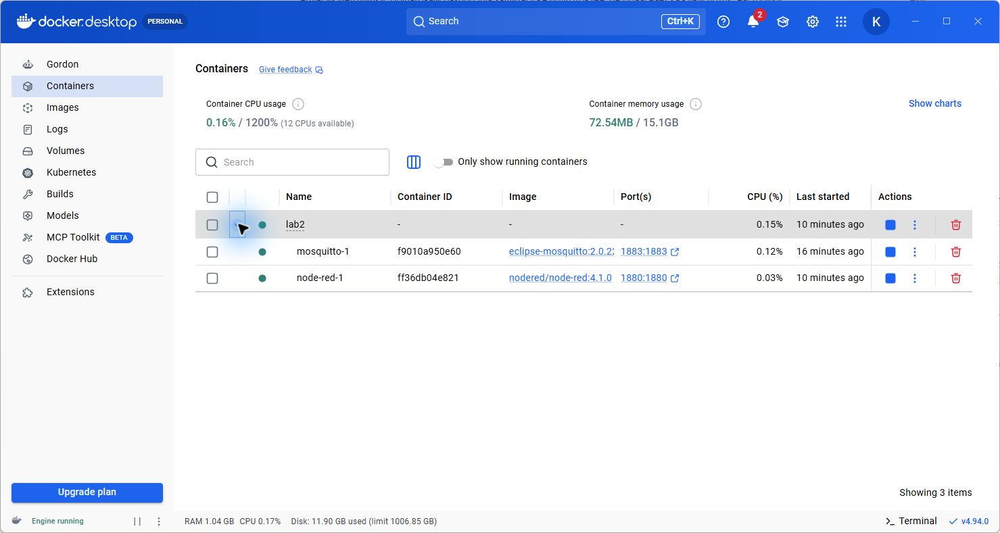

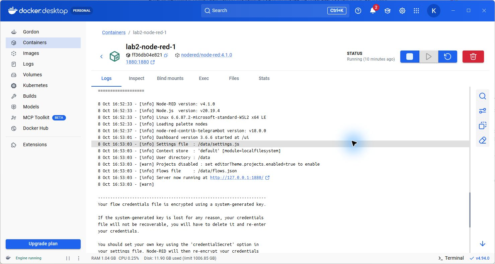

## Потоки

Каждая вкладка содержит фамилию и группу. Каждый поток экспортирован отдельно в `lab2/flows`. Debug настроен на полный объект сообщения. Вкладки 01–12 соответствуют заданиям методички, 13 — ачивке.

### 1. Inject → Debug

Inject каждые 5 секунд отправляет строку `Беляева` и topic `lab2/belyeva/basic`. В Debug видны payload, topic и идентификатор сообщения.

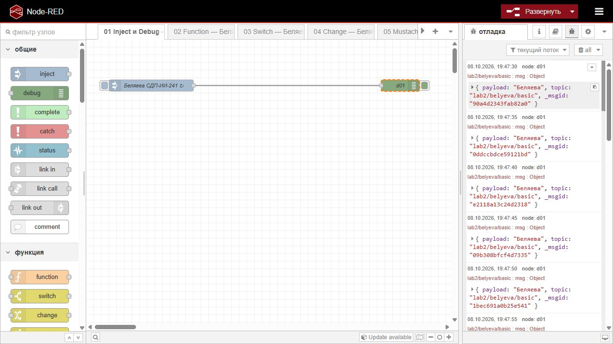

### 2. Function

Inject передаёт 20. Function использует const, let, массив, цикл for, if/else и объект. Массив `[20,5,10]` даёт сумму 35. В payload возвращаются student, group, total=35, level=high. `return msg` передаёт сообщение дальше.

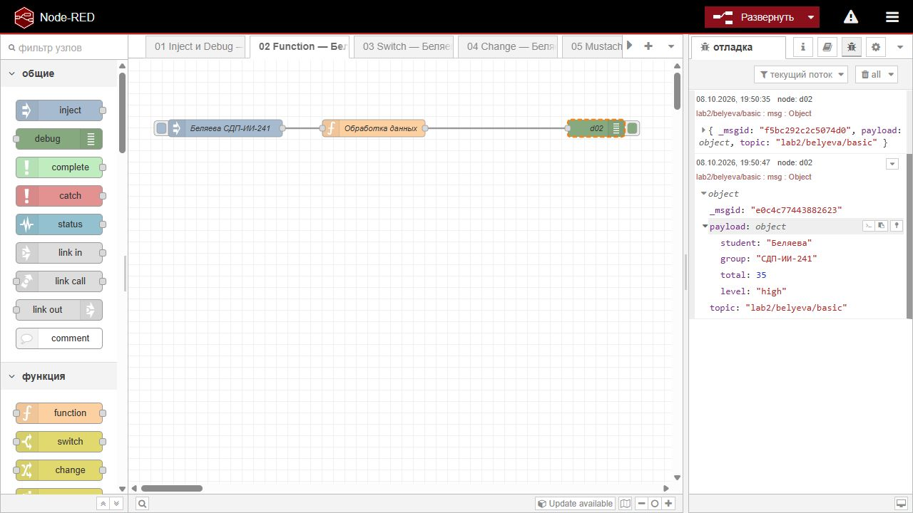

### 3. Switch

Switch проверяет `msg.payload.total`: >=30 направляется в первый Debug, <30 — во второй. Проверены оба входа: 20 → сумма 35 → high; 2 → сумма 17 → low.

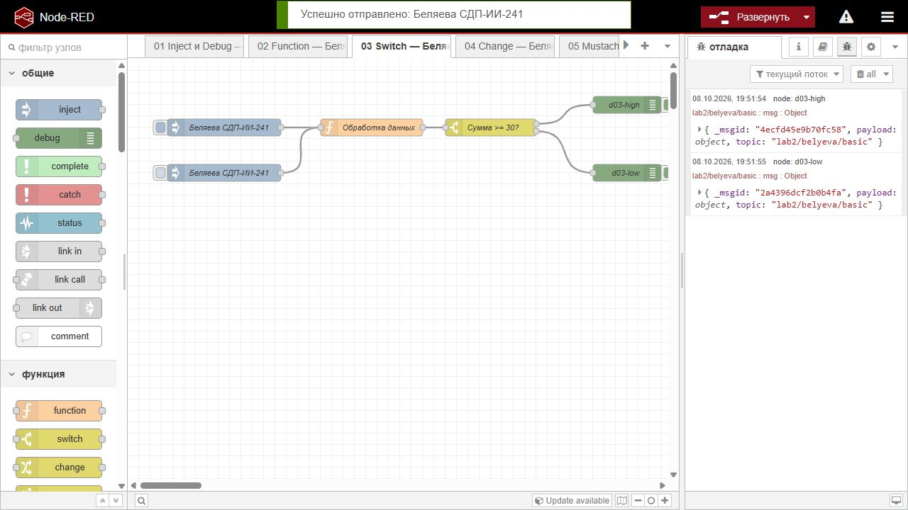

### 4. Change

Три правила Set задают topic `lab2/belyeva/change`, timestamp текущим временем и payload строкой с фамилией и группой. Полный объект виден в Debug.

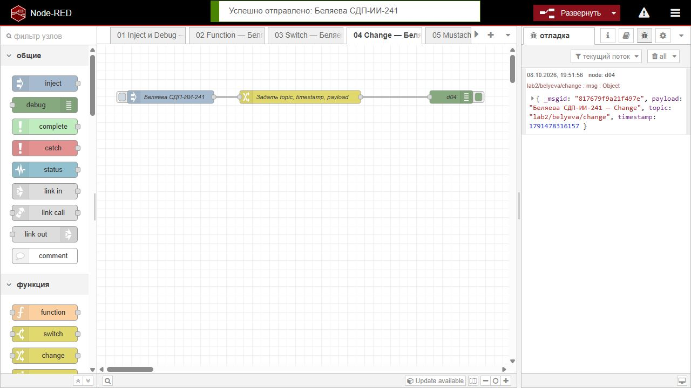

### 5. Mustache

Inject отправляет объект с тремя полями student, group, subject. Шаблон `Студентка {{payload.student}}, группа {{payload.group}} изучает {{payload.subject}}.` даёт строку «Студентка Беляева, группа СДП-ИИ-241 изучает Node-RED.».

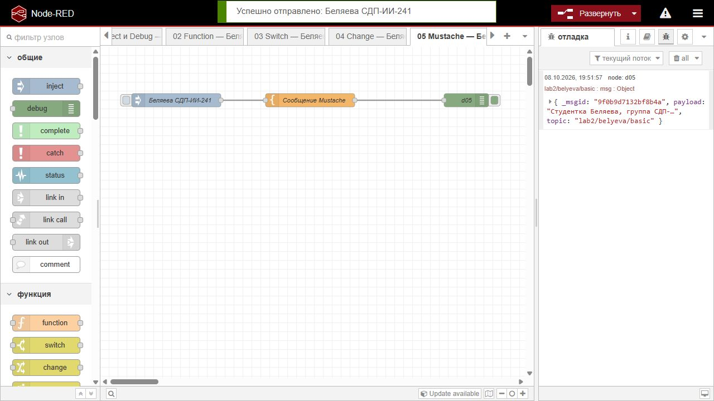

### 6. HTTP Request

GET `https://official-joke-api.appspot.com/random_joke` получает случайную шутку без авторизации. Return настроен на разобранный JSON. Проверены HTTP 200 и строковое поле setup в payload. Первоначальный catfacts.ninja заменён из-за ошибки DNS в данной среде; условие открытого API без токена соблюдено.

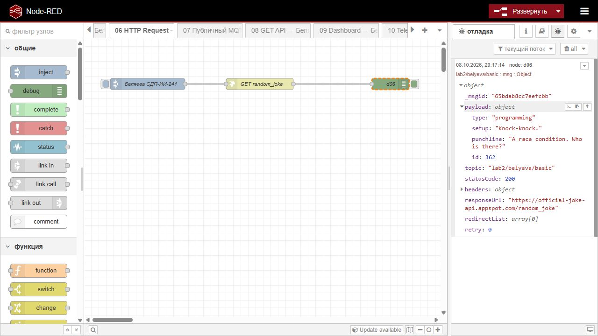

### 7. Публичный MQTT

Inject каждые 5 секунд запускает генерацию температуры 18–30. MQTT out публикует значение на `broker.hivemq.com:1883` в `student/belyeva/lab2/temperature`. MQTT in подписан на этот же топик: числа приходят в Debug. QoS 1, retain выключен, обе ноды подключены.

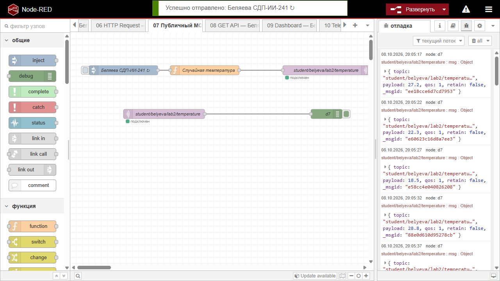

### 8. GET API

Созданы три независимые цепочки HTTP in → Function → HTTP response.

| Запрос | Ответ |
| --- | --- |
| `/api/text` | 200, текст с фамилией и группой |
| `/api/info` | 200, JSON с двумя полями student и group |
| `/api/items` | 200, массив из трёх блюд |
| `/api/items?id=1` | 200, объект «Пицца» |
| `/api/items?id=abc` | 400, неправильный id |
| `/api/items?id=99` | 404, блюдо не найдено |

Формат id проверяется до преобразования в число. Проверены также 0, отрицательное, дробное и пустое значения — все дают 400. Примеры запросов и ответов находятся в [api.md](api.md), фактические результаты — в [verification.json](verification.json).

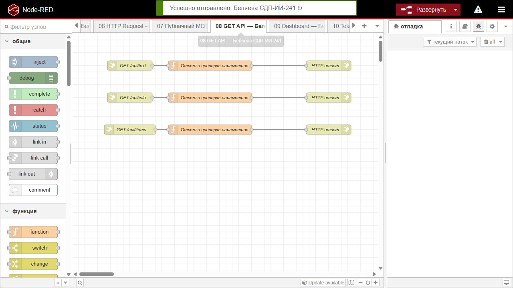

Браузерные снимки ответов добавлены 16.10.2026. Для JSON включено встроенное автоформатирование браузера; содержимое ответов не изменялось.

GET `http://127.0.0.1:1880/api/text` — текстовый ответ, HTTP 200.


GET `http://127.0.0.1:1880/api/info` — фамилия и группа в JSON, HTTP 200.

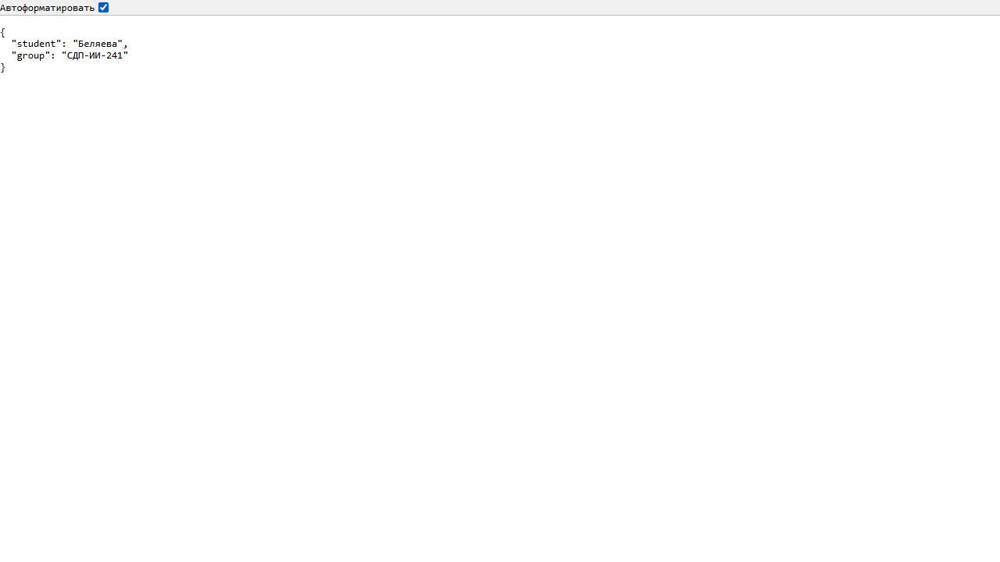

GET `http://127.0.0.1:1880/api/items?id=1` — найденное блюдо, HTTP 200.

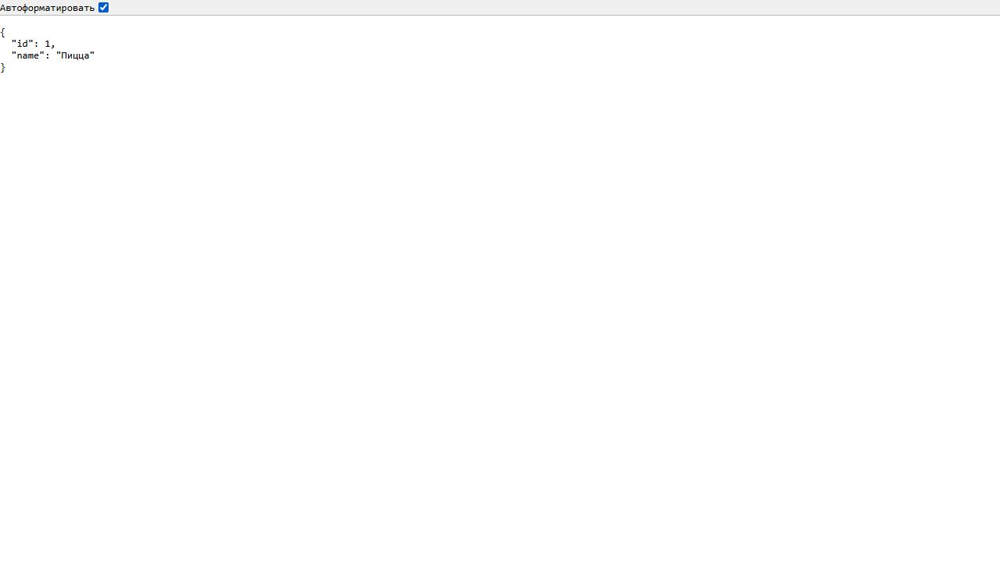

GET `http://127.0.0.1:1880/api/items?id=abc` — неправильный формат параметра, HTTP 400.

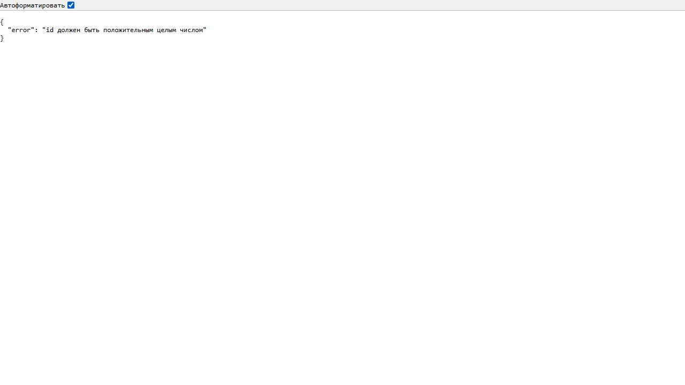

GET `http://127.0.0.1:1880/api/items?id=99` — блюдо отсутствует, HTTP 404.

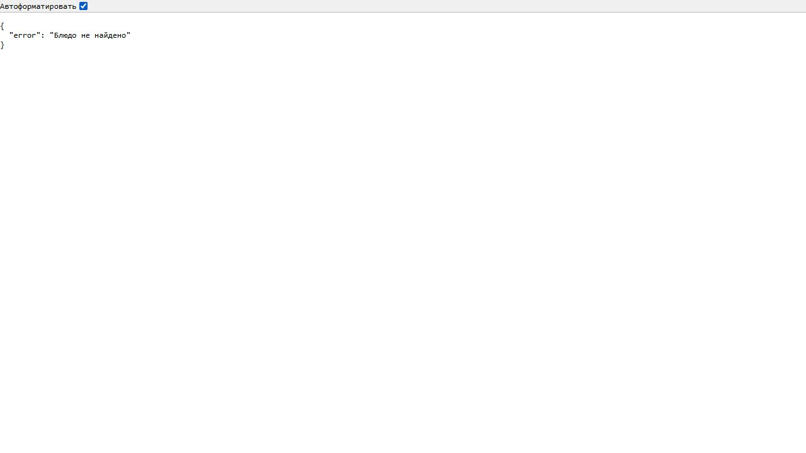

### 9. Dashboard

В node-red-dashboard созданы вкладка и группа с фамилией и группой. Датчик выдаёт случайную температуру каждые 5 секунд одновременно на Gauge и Chart. Прибор показывает текущее значение, график — историю. Адрес: `http://localhost:1880/ui`.

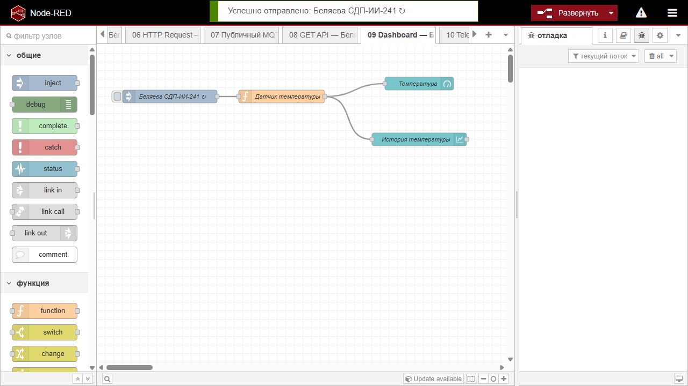

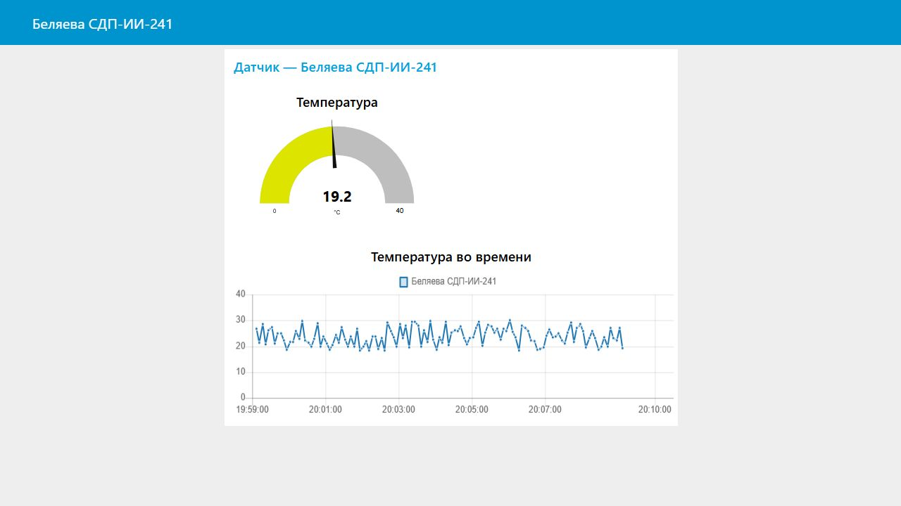

### 10. Telegram

Через BotFather создан `tvl_lab2_belyeva_bot`. Receiver работает в polling. Function выбирает ответ для /start, /info или обычного текста; Sender отправляет его в chatId входного сообщения. Токен отсутствует в экспортированных JSON и отслеживаемых файлах.

Проверка проведена студенткой в Telegram 08.10.2026; ответы переданы для сверки:

| Время | Сообщение | Ответ |
| --- | --- | --- |
| 20:07 | `/start` | Привет! Я бот Беляевой, СДП-ИИ-241. Команда /info расскажет о лабораторной. Остальные сообщения я повторяю. |
| 20:08 | `/info` | Лабораторная №2: Node-RED. Беляева, СДП-ИИ-241. Ачивка №1 — локальный MQTT. |
| 20:08 | `Привет, это Беляева` | Эхо: Привет, это Беляева |

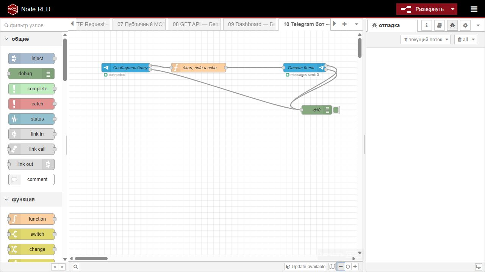

На скриншоте переписки видны ответы на `/start`, `/info` и эхо сообщения «Привет, это Беляева».

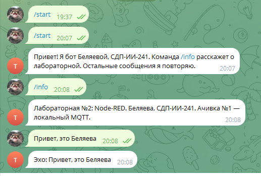

### 11. Файлы

Первая цепочка формирует заказ с student, group, createdAt и order, сериализует JSON и перезаписывает `/data/order.json`. Вторая независимо читает файл как UTF-8 в Debug. Файл находится в bind mount.

После `docker compose restart node-red` прочитан старый файл без повторной записи: содержимое и createdAt не изменились. Фактический результат: [persistence-check.json](persistence-check.json), `fileUnchanged: true`.

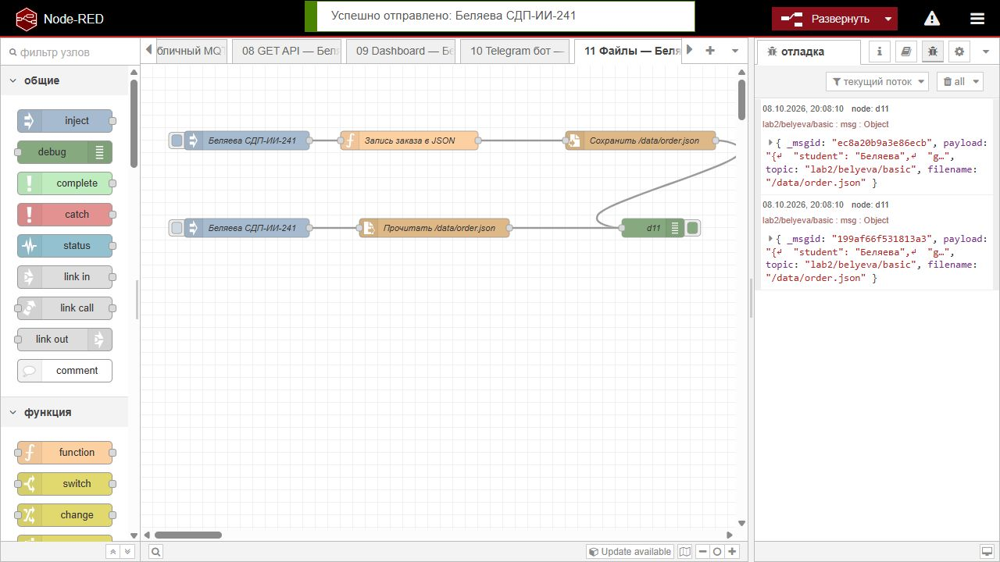

### 12. Контекст

Function читает orderCount через flow.get, увеличивает и сохраняет через flow.set. В settings.js выбран localfilesystem с интервалом сброса 5 секунд. Перед перезапуском в проверке ожидалось 6 секунд: счётчик был 4, после перезапуска и нового Inject стал 5. Результат: [persistence-check.json](persistence-check.json).


## Ачивка №1. Локальный MQTT

Mosquitto запущен отдельным контейнером. В `mosquitto/mosquitto.conf` заданы listener 1883, учебный доступ без пароля, persistence в `/mosquitto/data` и логи stdout. Данные брокера подключены к локальной папке.

Из Node-RED адрес — `mosquitto:1883`, поскольку сервисы находятся в общей сети Docker. localhost внутри контейнера обозначал бы сам Node-RED. На компьютере опубликован `127.0.0.1:1883`.

Вкладка 13 содержит Inject → Function → MQTT out и MQTT in → Debug. Обе MQTT-ноды используют `student/belyeva/lab2/local`, QoS 1, retain выключен. Получение опубликованных чисел проверено в Debug и автоматической проверкой.

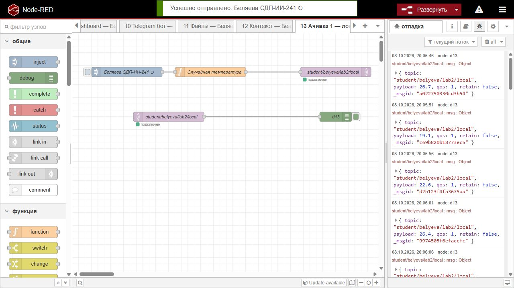

Локальный брокер работает на моём компьютере, его конфигурацию и запуск контролирую я; обмен внутри Docker не требует интернета. Публичный HiveMQ обслуживается сторонним провайдером и требует интернет. MQTT использует publish/subscribe: брокер пересылает публикации подписчикам соответствующего топика. QoS 1 гарантирует доставку как минимум один раз, поэтому возможны дубликаты.

Команды для демонстрации в Git Bash из папки lab2:

```bash
docker compose ps
docker compose exec mosquitto mosquitto_sub -h localhost -t student/belyeva/lab2/local -C 1 -W 15 -v
docker compose exec mosquitto mosquitto_pub -h localhost -t student/belyeva/lab2/local -m 25.5 -q 1
```

## Использование ИИ

ИИ использовался при подготовке потоков, JavaScript, Mustache, проверок и объяснений. Код проверен на работающем Node-RED. Основные задания к генерации ниже приведены в сокращённой форме с сохранением смысла:

1. «Составить Function с let/const, массивом, for, if/else и объектом; включить Беляева, СДП-ИИ-241; вернуть msg».
2. «Составить Mustache для объекта student, group, subject и показать текстовый результат».
3. «Реализовать три GET-маршрута, проверку query id и ответы 200, 400, 404 с отдельными HTTP response».
4. «Для Telegram receiver/sender реализовать /start, /info и эхо, сохраняя chatId».
5. «Поднять Mosquitto в Docker Compose, проверить публикацию/подписку из Node-RED и объяснить отличие от публичного брокера».

## Проверка и Git

`verify.mjs` выполнил 10 HTTP-запросов и проверил Debug базовых потоков, обе ветви Switch, разобранный ответ внешнего API, файл, контекст, публичный и локальный MQTT. Результат PASS. `verify-persistence.mjs` проверил файл и счётчик после настоящего перезапуска контейнера — PASS. Telegram проверен студенткой в реальном чате, Dashboard — в браузере.

Повторная проверка из lab2 при установленном Node.js 22+:

```bash
node verify.mjs
node verify-persistence.mjs
```

Первая команда перезаписывает учебный файл заказа. Вторая перезапускает Node-RED и увеличивает счётчик. Проверки обновляют JSON фактических результатов.

Этапы сохранены отдельными коммитами: Docker и Mosquitto, потоки, запуск и API, исправления и проверки, отчёт и скриншоты. Автор соответствует существующим настройкам Git репозитория; коммиты создаются через Git Bash. Runtime и секреты не отслеживаются.

## Вывод

Созданы и проверены 12 обязательных потоков и поток локального MQTT. Проверены HTTP-статусы, обработка данных, MQTT, dashboard, команды и эхо Telegram, сохранение файла и контекста после перезапуска. Браузерные снимки GET API и скриншот переписки Telegram приложены к отчёту.
