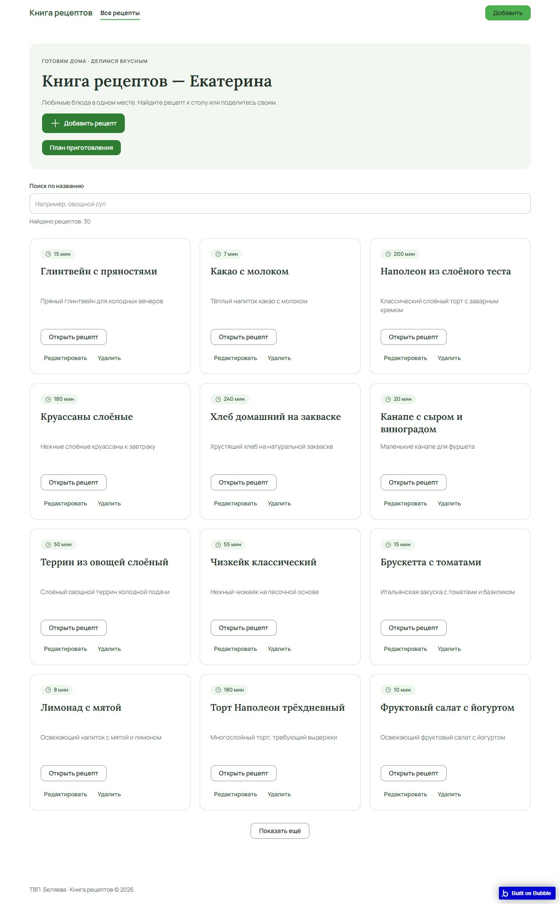
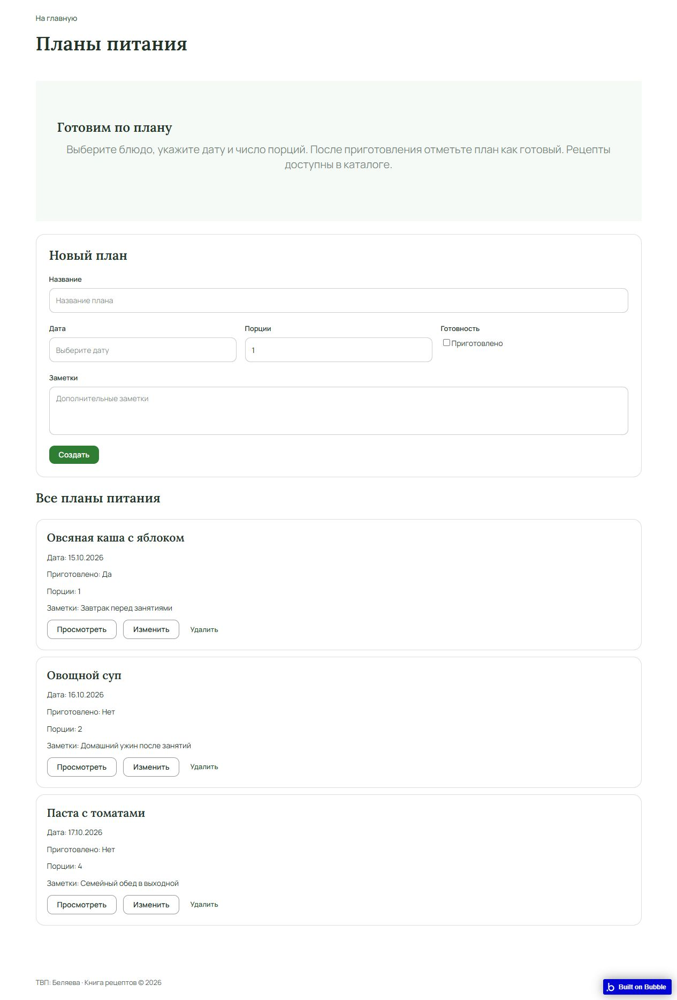

# Лабораторная работа №3. Bubble

**Студентка:** Беляева Екатерина. **Группа:** СДП-ИИ-241.

**Дата выполнения:** 15.10.2026. **Дополнительные задания:** без ачивки.

## Цель работы

Освоить создание приложения в Bubble, настройку интерфейса, проектирование базы данных и реализацию workflows для создания, чтения, изменения и удаления записей.

## Среда и приложение

Работа выполнена в браузере на бесплатном плане Bubble (Start with basic features). Создано одно публичное приложение «Книга рецептов» без обязательной регистрации. Главная страница содержит каталог рецептов, страница meal_plans — планы приготовления блюд. Обе страницы состоят из шапки, основной части и подвала.

| Страница | Назначение |
| --- | --- |
| [Каталог рецептов](https://my-app-261015-99229.bubbleapps.io/version-test/) | Поиск, просмотр и управление рецептами |
| [Планы приготовления](https://my-app-261015-99229.bubbleapps.io/version-test/meal_plans) | Создание, просмотр, изменение и удаление MealPlan |
| [Редактор Bubble](https://bubble.io/page?id=my-app-261015-99229) | Настройка страниц, данных и workflows |

Используется dev-версия приложения — version-test. Локальный сервер и установка зависимостей не требуются.

### Главная страница

В каталоге размещены заголовок «Книга рецептов — Екатерина», поиск по названию, карточки блюд и кнопки управления рецептами. На страницу планов ведёт кнопка «План приготовления». В подвале указано «ТВП: Беляева».

### Страница планов приготовления

Страница meal_plans содержит подсказку «Готовим по плану», форму нового плана, список записей и действия просмотра, изменения и удаления. На снимке видны три начальные записи и подвал страницы.

## Создание заготовки

Подготовлена заготовка каталога с поиском, формой рецепта и действиями управления записями. Первоначально созданы страницы index, reset_pw и 404, тип данных «Рецепт» и демонстрационные данные. В начальном Preview отображались 30 рецептов.

## Исследование Build Guides

Изучено руководство [«Форма добавления и редактирования рецептов»](https://bubble.io/buildguides/1792088045542x376394154585624640). Полезны соответствие полей формы типам базы, разделение создания и изменения существующей записи, проверка обязательных полей перед сохранением. Для MealPlan применена проверка обязательного названия на уровне Input, дополнительно к условиям workflows. Снимки до и после приведены в разделе проверки.

## Настройка интерфейса

В Design через Properties изменён текст заголовка на «Книга рецептов — Екатерина».

В Global → Variables создана новая Color-переменная `recipe-primary` со значением `#2E7D32` и описанием назначения. В Global → Styles создан стиль `Recipe Primary Button` для Button: фон ссылается на `recipe-primary`, текст и иконка — на белый Surface. Стиль назначен кнопке «Добавить рецепт». Ссылка на переменную позволяет централизованно менять акцент, стиль позволяет повторно использовать оформление.

## Готовый компонент

В Design → Component Library → Marketing выбран готовый блок «Our unique philosophy», которого до этого на странице не было. Блок перетащен на meal_plans между заголовком и формой. Через Properties заголовок заменён на «Готовим по плану», описание — на инструкцию по планированию блюда. Заголовку назначен Heading 2, фону контейнера — светло-зелёный Success 10; контейнер переименован в Recipe Help. Ненужные изображение-заглушка и кнопка Sign up удалены из добавленного блока. Дополнительные плагины не понадобились.

## Данные MealPlan

В Data → Data types создан MealPlan:

| Поле | Тип | Назначение |
| --- | --- | --- |
| title | text | Название блюда |
| planned_date | date | Дата и время приготовления |
| is_cooked | yes/no | Отметка о приготовлении |
| servings | number | Количество порций |
| notes | text | Заметка |

Через App Data → New entry внесены три записи: «Овсяная каша с яблоком» (15 октября, приготовлена, 1 порция), «Овощной суп» (16 октября, 2 порции), «Паста с томатами» (17 октября, 4 порции). Это демонстрационные данные Development, а не личные записи пользователей.

## Страница meal_plans и workflows

На странице используются Input, Date/Time Picker, Checkbox, Multiline Input, Button, Repeating Group, группы подробностей, Popup подтверждения удаления и Alert ошибки. В custom states страницы хранятся выбранный и редактируемый MealPlan.

| Действие | Событие и шаги |
| --- | --- |
| Create | «Создать»: Create a new MealPlan с данными формы, затем Reset Form |
| Read | «Просмотреть»: записать текущую запись строки в состояние «Выбранный план», показать подробности |
| Update | «Изменить»: выбрать редактируемую запись; «Сохранить изменения»: Make changes to MealPlan, очистить состояние и форму |
| Delete | «Удалить»: передать выбранную запись в Popup; «Да, удалить»: удалить MealPlan из Popup, очистить связанные состояния и скрыть Popup |

Создание и сохранение разрешены только при непустом title после trim и servings ≥ 1. Для ошибочных значений предусмотрены отдельные workflows с Alert. На странице десять workflows с учётом отмены, подтверждения и ошибок.

### Применённая идея из Build Guide

В дополнение к проверке в workflows включён Make required у Title Input: пустое название считается невалидным уже на уровне элемента формы. Это применение рекомендации руководства проверять обязательные поля перед записью данных.

### Проверка в Preview

Проверка выполнена 15.10.2026 в Development:

1. Создан план «Проверка CRUD — салат» на 18.10.2026, 2 порции, с демонстрационной заметкой. Форма очистилась, запись появилась в списке.
2. После перезагрузки запись осталась. Кнопка «Просмотреть» показала её поля в группе подробностей.
3. Через «Изменить» и «Сохранить изменения» изменены название на «Проверка CRUD — салат обновлён», порции на 3 и отметка приготовления на «Да». После перезагрузки новые значения сохранились.
4. Кнопка «Удалить» открыла подтверждение. После «Да, удалить» исчезла только тестовая запись; осталось три исходных плана.
5. Пустая форма не создала запись: появился Alert с указанием заполнить название и число порций не меньше 1.

Дополнительная проверка: при названии «Проверка некорректных порций» и servings = 0 показан Alert, четвёртая запись не создалась.

## История коммитов

Работа сохранена этапами через Git Bash с автором, настроенным в репозитории: Беляева Екатерина. Коммиты, в которых менялись файлы `lab3`:

| Коммит | Дата | Изменения |
| --- | --- | --- |
| [ab4ad18](https://github.com/Katsia999/visual-programming-labs-Belyeva/commit/ab4ad18ecc41e4655e6b092ad6630b4bf73b8acb) | 2026-10-15 | Добавила задания и промпты для третьей лабораторной |
| [049bd4a](https://github.com/Katsia999/visual-programming-labs-Belyeva/commit/049bd4ab23e231073482450c4338e1b14e9d6671) | 2026-10-15 | Добавила приложение Bubble и его предпросмотр |
| [f2bff93](https://github.com/Katsia999/visual-programming-labs-Belyeva/commit/f2bff93ff3da98e36b7d40ade73da407ca100520) | 2026-10-15 | Настроила оформление и данные MealPlan |
| [fde8a92](https://github.com/Katsia999/visual-programming-labs-Belyeva/commit/fde8a927a3ac967878f8c2b5bd5b20d0393eb88d) | 2026-10-15 | Добавила действия MealPlan и проверила работу с данными |
| [72433c2](https://github.com/Katsia999/visual-programming-labs-Belyeva/commit/72433c20da743e0ae4a3d141748b198e7f58b4dc) | 2026-10-15 | Дополнила отчёт и скриншоты третьей лабораторной |

Приложение хранится в Bubble; в репозитории сохранены отчёт и скриншоты выполнения работы.

## Вывод

Создано и проверено приложение «Книга рецептов» с отдельной страницей планирования приготовления. Настроены заголовок, глобальная цветовая переменная, стиль кнопки и готовый компонент. Для MealPlan добавлены пять полей четырёх типов и три начальные записи. Реализован полный CRUD: создание, просмотр, изменение и удаление выбранной записи. Проверены сохранение данных после перезагрузки, подтверждение удаления и отклонение некорректных значений.

## Использование ИИ

ИИ использовался для генерации первоначального каркаса приложения, предложения названия и полей MealPlan, создания интерфейса страницы meal_plans и её workflows. Build Guides использовались для получения рекомендаций по формам и проверке данных. Заголовок, цветовая переменная, стиль и готовый компонент настроены через визуальные инструменты; тип MealPlan, его поля и начальные записи добавлены через Data. Результат проверен в Preview полным циклом CRUD.

Основные задачи, для которых использовался ИИ:

1. Подготовка заготовки публичного каталога рецептов с поиском и действиями управления записями.
2. Предложение структуры MealPlan с полями разных типов.
3. Подготовка страницы meal_plans с формой, списком и отдельными workflows CRUD.
4. Уточнение работы с существующими полями и перехода между страницами.
5. Получение рекомендаций Build Guides по устройству форм и проверке значений.

Полные тексты запросов сохранены отдельно в [prompts.md](prompts.md).
