# Лабораторная работа №3. Bubble

**Студентка:** Беляева Екатерина. **Группа:** СДП-ИИ-241.

## Цель

Освоить генерацию приложения в Bubble, ручную настройку интерфейса, типы данных и workflows для создания, чтения, изменения и удаления записей.

## Тема и состояние работы

Выбрана тема каталога рецептов «Книга рецептов». Дополнительная сущность для части 4 — план приготовления блюда MealPlan.

15.10.2026 выполнен вход в Bubble, отправлен промпт каталога рецептов и запущена генерация. Выбран бесплатный режим Start with basic features. Ачивка в текущий объём работы не входит. Dev-ссылка и результаты проверки будут добавлены после завершения генерации и настройки.

## Промпты

Первичная генерация:

```text
Создай приложение на тему «Каталог рецептов» с названием «Книга рецептов».
Пусть этот сайт будет публичным, без обязательной регистрации.
Страницу обязательно создай по структуре header + body + footer.
Обязательно укажи в заготовке следующую строку: «ТВП: Беляева».
Добавь несколько интерактивных элементов, реализующих CRUD для рецептов: создание, просмотр, редактирование и удаление.
Интерфейс должен быть на русском языке. На главной странице размести заголовок «Книга рецептов», поиск по названию, список рецептов и кнопку добавления рецепта. Для рецепта используй название, описание, ингредиенты и время приготовления в минутах.
Используй спокойное светлое оформление с зелёным акцентом и удобную адаптивную компоновку. В подвале повтори строку «ТВП: Беляева».
```

Промпты следующих этапов сохранены в [prompts.md](prompts.md).

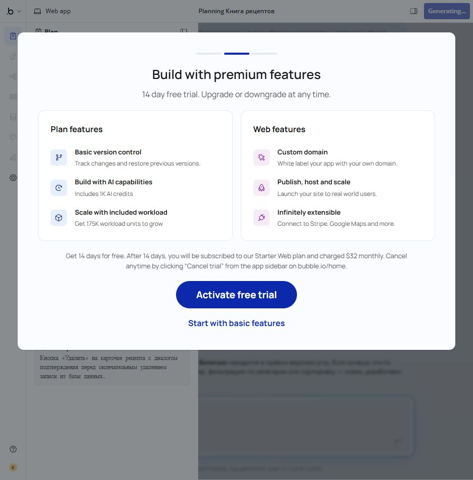

## Результат первичной генерации

Создано приложение «Книга рецептов». Bubble сообщил о создании 3 страниц, 87 элементов, 15 workflows и одного пользовательского типа данных «Рецепт». В начальном Preview отображались 30 демонстрационных рецептов, поиск и кнопки управления записями.

[Редактор приложения](https://bubble.io/page?id=my-app-261015-99229)

[Dev-версия каталога](https://my-app-261015-99229.bubbleapps.io/version-test/)

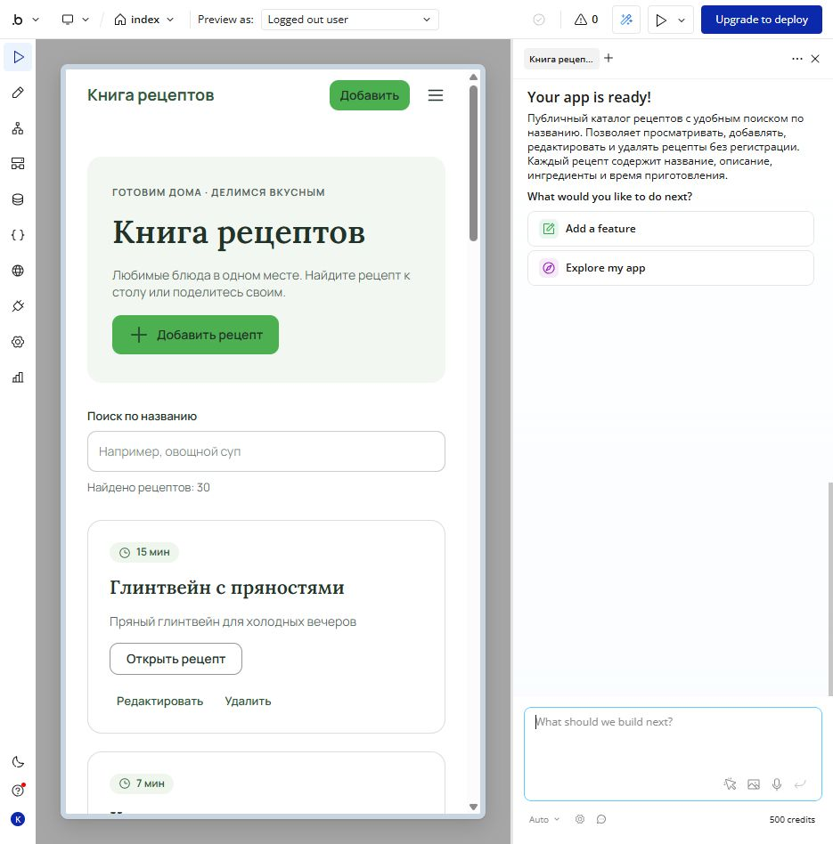

## Проверка

Текущий список требований находится в [checklist.md](checklist.md). CRUD для MealPlan будет проверен после создания новой страницы.

## Исследование Build Guides

В разделе Build Guides использовано описание:

```text
Публичный каталог рецептов с поиском по названию, карточками рецептов, формой добавления и редактирования. Дополнительная страница планирования приготовления: название блюда, дата, число порций, отметка о приготовлении, заметка. Нужны рекомендации по Repeating Group, поиску, формам и CRUD через workflows.
```

Изучено руководство [«Форма добавления и редактирования рецептов»](https://bubble.io/buildguides/1792088045542x376394154585624640). Полезны соответствие полей формы типам базы, разделение создания и изменения существующей записи, проверка обязательных полей перед сохранением. Для MealPlan выбрана идея валидации названия и числа порций; её результат будет зафиксирован после проверки.

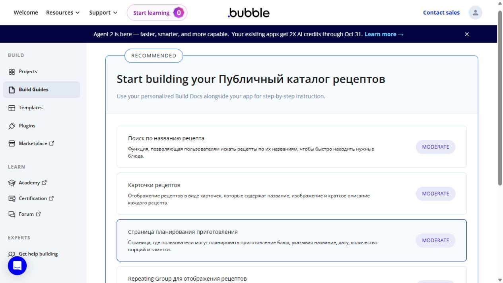

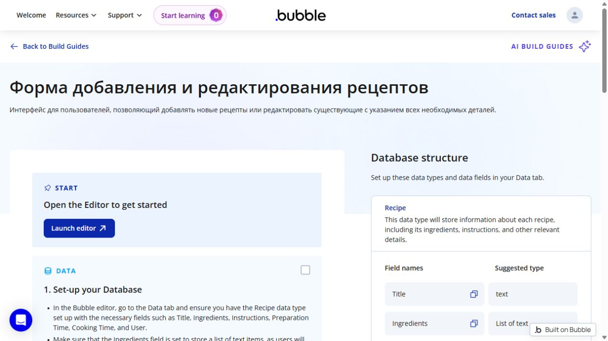

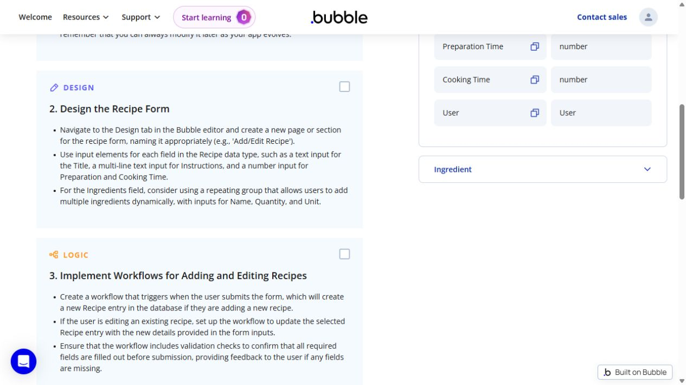

## Ручная настройка оформления

В Design через Properties изменён текст заголовка на «Книга рецептов — Екатерина». AI для этого изменения не использовался.

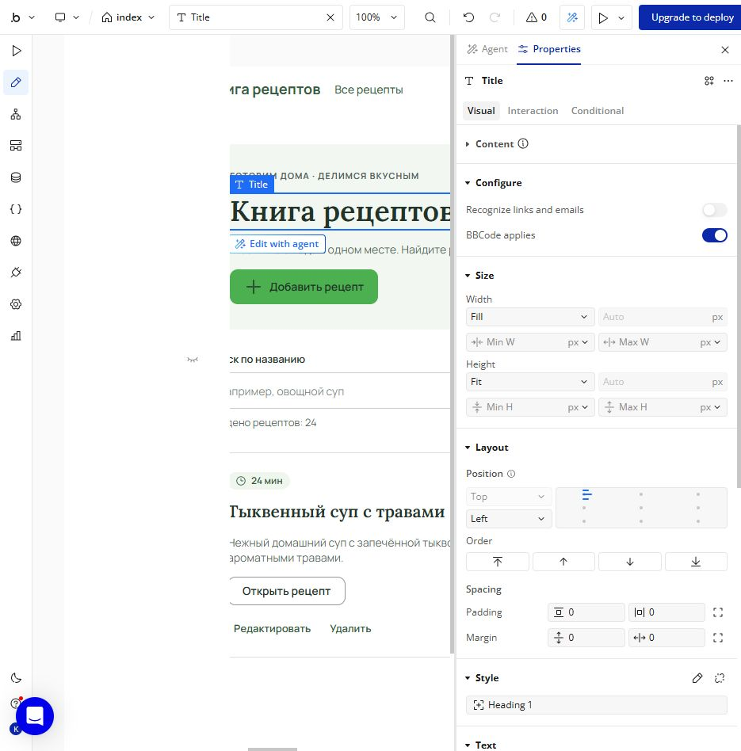

В Global → Variables создана новая Color-переменная `recipe-primary` со значением `#2E7D32` и описанием назначения. В Global → Styles создан стиль `Recipe Primary Button` для Button: фон ссылается на `recipe-primary`, текст и иконка — на белый Surface. Стиль вручную назначен кнопке «Добавить рецепт». Ссылка на переменную позволяет централизованно менять акцент, стиль позволяет повторно использовать оформление.

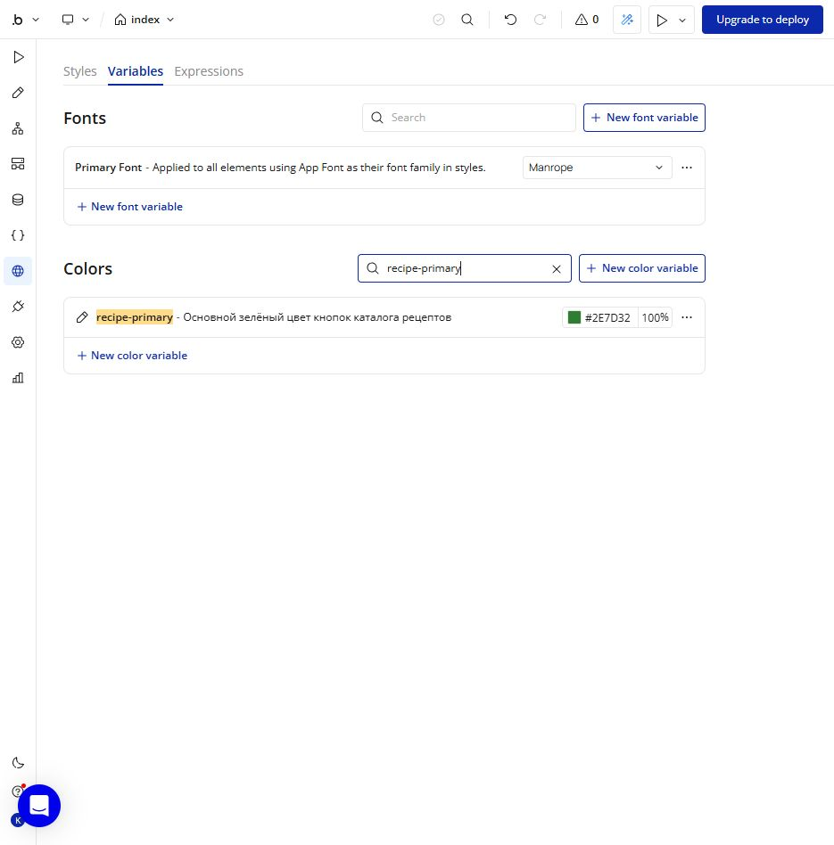

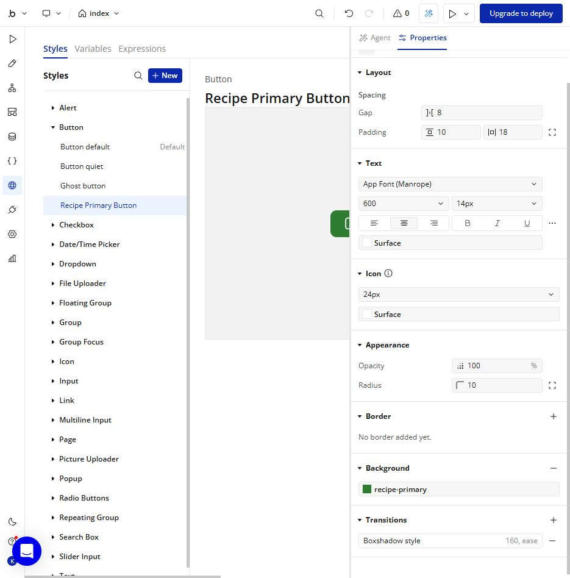

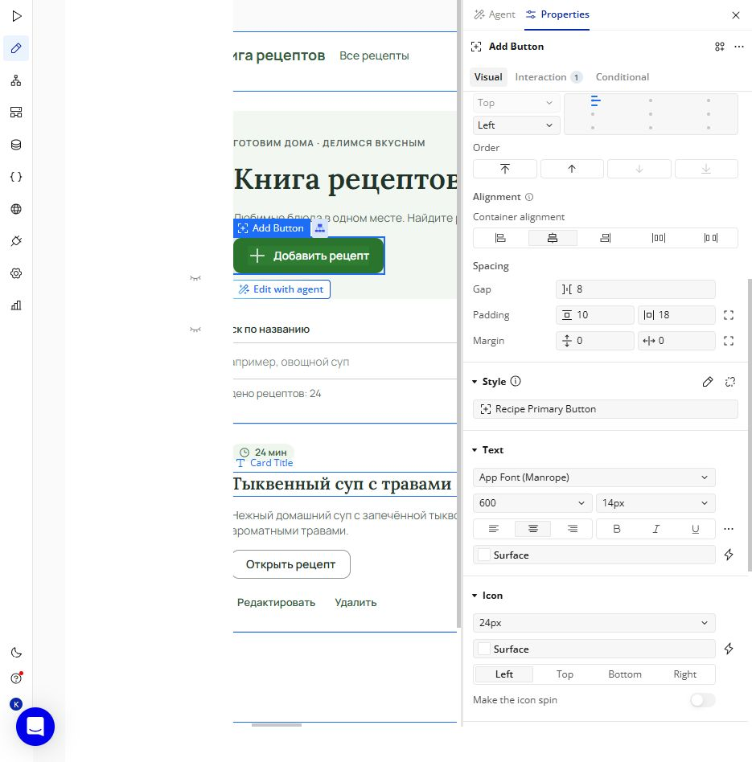

## Новая сущность MealPlan

Внешний AI предложил сущность по следующему промпту:

```text
Предложи название и поля новой сущности для приложения Bubble «Каталог рецептов». Эта сущность должна отличаться от Recipe, созданной при первичной генерации. Нужна сущность для планирования приготовления блюда: название блюда, запланированная дата, отметка о приготовлении, количество порций и заметка. Укажи английские имена полей Bubble и их типы; нужны минимум три разных типа. Не создавай сущность автоматически: я добавлю её вручную в Data и внесу три записи через App Data.
```

В Data → Data types вручную создан MealPlan:

| Поле | Тип | Назначение |
| --- | --- | --- |
| title | text | Название блюда |
| planned_date | date | Дата и время приготовления |
| is_cooked | yes/no | Отметка о приготовлении |
| servings | number | Количество порций |
| notes | text | Заметка |

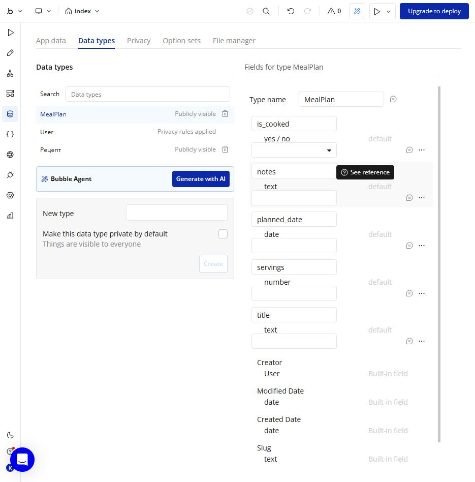

Через App Data → New entry вручную внесены три записи: «Овсяная каша с яблоком» (15 октября, приготовлена, 1 порция), «Овощной суп» (16 октября, 2 порции), «Паста с томатами» (17 октября, 4 порции). Это демонстрационные данные Development, а не личные записи пользователей.

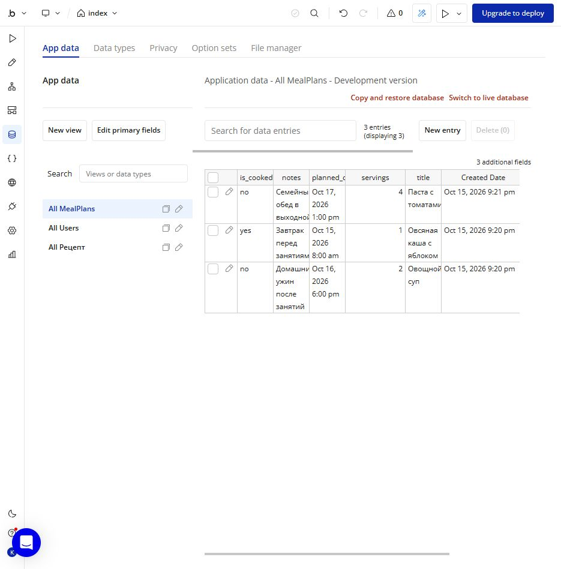
