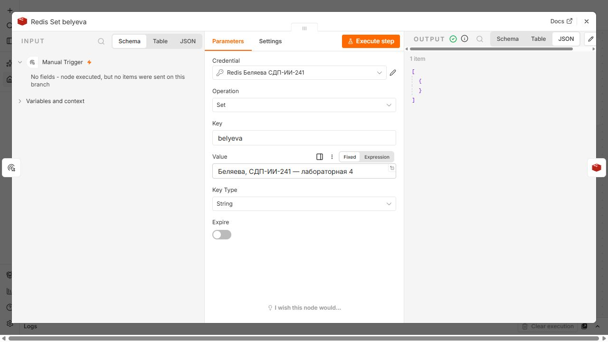
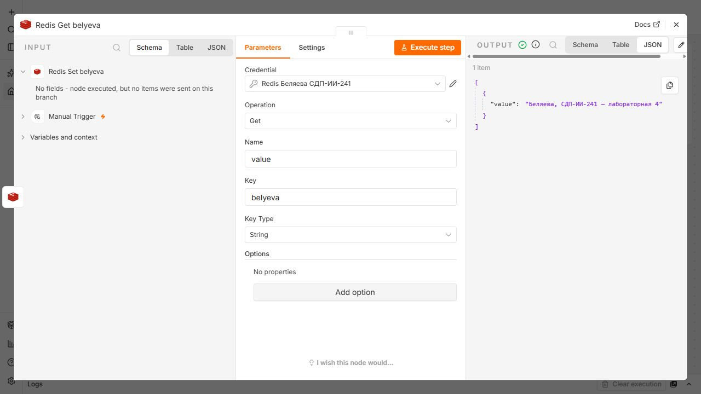
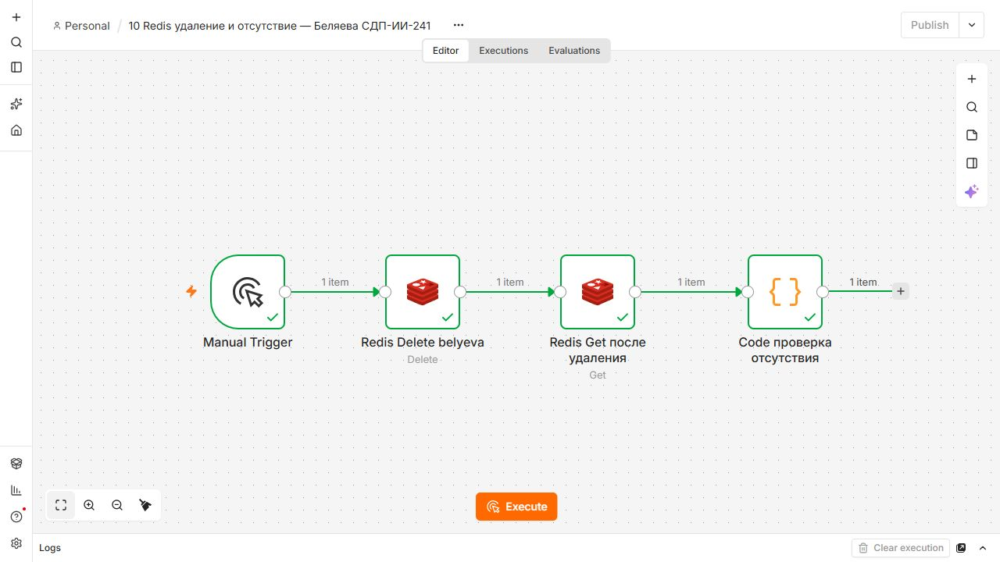
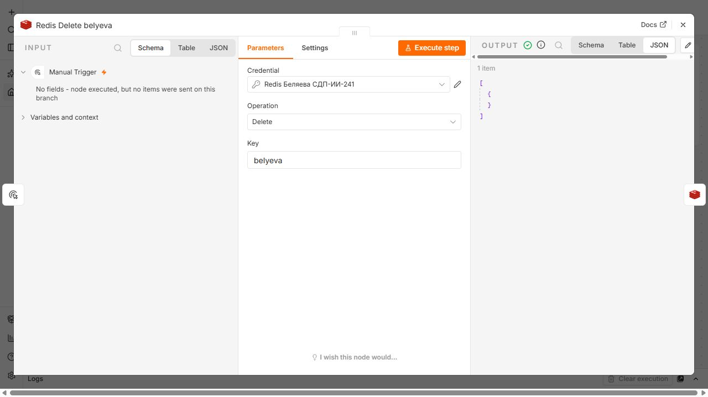

# Redis в лабораторной работе 4

**Студентка:** Беляева Екатерина. **Группа:** СДП-ИИ-241.

## Установка и подключение

Redis 7.4.11 запущен через Docker Compose отдельным сервисом `redis`. Порт компьютера `127.0.0.1:6379` направлен в порт 6379 контейнера. Включён AOF (`--appendonly yes`), папка `runtime/redis` подключена к `/data`. Команда `docker compose exec redis redis-cli PING` возвращает PONG.

В n8n создан credential `Redis Беляева СДП-ИИ-241`: Host `host.docker.internal`, Port `6379`, Database `0`, Password пустой, SSL выключен. Это локальная учебная установка. Экспорт workflow содержит только ссылку на credential; runtime и локальный аккаунт не отправляются в GitHub.

`host.docker.internal` указывает на Windows-хост. `localhost` внутри n8n указывал бы на контейнер n8n, где Redis не запущен. Compose также даёт внутренний адрес `redis`, но в работе использован адрес из методички.

## Создание и чтение

Выполнен [flow-09-redis.json](../flows/flow-09-redis.json): Manual Trigger → Redis Set belyeva → Redis Get belyeva.

Set: Key `belyeva`, Value `Беляева, СДП-ИИ-241 — лабораторная 4`, Key Type String, Expire выключен. Set создаёт ключ либо перезаписывает существующее значение. Get читает ключ и возвращает значение в поле `value`.






Дополнительная проверка настоящими командами Redis из Git Bash в папке `lab4`:

```bash
docker compose exec redis redis-cli --raw GET belyeva
# Беляева, СДП-ИИ-241 — лабораторная 4
docker compose exec redis redis-cli EXISTS belyeva
# 1
docker compose exec redis redis-cli TTL belyeva
# -1, срок жизни не задан
```

## Удаление и проверка отсутствия

После 09 выполнен [flow-10-redis.json](../flows/flow-10-redis.json): Manual Trigger → Redis Delete belyeva → Redis Get после удаления → Code проверка отсутствия.





В методичке указана Redis Exists, но в [встроенной Redis-ноде](https://docs.n8n.io/integrations/builtin/app-nodes/n8n-nodes-base.redis/) n8n 2.44.6 такой операции нет. Реализована проверка Get + строгое сравнение с `null`. Если значение не null, Code вызывает ошибку. При успехе возвращаются `key: "belyeva"`, `value: null`, `exists: false`, `deleted: true`. Это эквивалентная проверка отсутствия строкового ключа в данном задании; значение false появляется только после фактического Get и проверки.


Дополнительно непосредственно Redis подтвердил отсутствие ключа:

```bash
docker compose exec redis redis-cli EXISTS belyeva
# 0
docker compose exec redis redis-cli --raw GET belyeva
# пустой вывод: nil
```

После проверки ключ оставлен удалённым. Для защиты нужно повторить 09 → 10. Фактические выходы всех нод сохранены в [verification.json](verification.json). Повторное удаление несуществующего ключа не является ошибкой Redis.

## Что хранится между запусками

Redis держит рабочие данные в памяти, а AOF записывает операции на диск и позволяет восстановить их при перезапуске. JSON workflow хранится в БД n8n, а сам ключ — в Redis. Перезапуск n8n не должен изменять ключ Redis. Удаление контейнера и удаление bind mount — разные действия: локальные данные остаются в папках runtime, пока эти папки не удалены.
