# Лабораторная работа №4. n8n

**Студентка:** Беляева Екатерина. **Группа:** СДП-ИИ-241.

**Дата выполнения:** 22.10.2026. **Дополнительные задания:** без ачивки.

## Цель работы

Освоить n8n как low-code платформу автоматизации: развернуть среду через Docker, изучить основные ноды, обработку данных на JavaScript, HTTP-запросы и расписание, подключить Redis и проверить создание, чтение и удаление ключа.

## Среда и установка

Работа выполнена в Windows с Docker Desktop и WSL 2. n8n и Redis запущены через `docker-compose.yml` в папке `lab4`.

| Компонент | Версия и параметры |
| --- | --- |
| Docker Desktop | 4.94.0, уже установлен |
| Docker Engine | 29.8.2 |
| n8n | 2.44.6, образ `n8nio/n8n:2.44.6` |
| Redis | 7.4.11, образ `redis:7.4.11`, ветка Redis 7 |
| Редактор | `http://localhost:5678` |
| Часовой пояс | `Europe/Minsk` |

Перед запуском устранена ошибка устаревшего сокета Docker Secrets Engine: аварийные процессы остановлены, папка служебного сокета переименована в резервную и Docker запущен повторно. Контейнеры и образы прежних лабораторных сохранены. Подобная ошибка описана в [трекере Docker](https://github.com/docker/for-win/issues/15064).

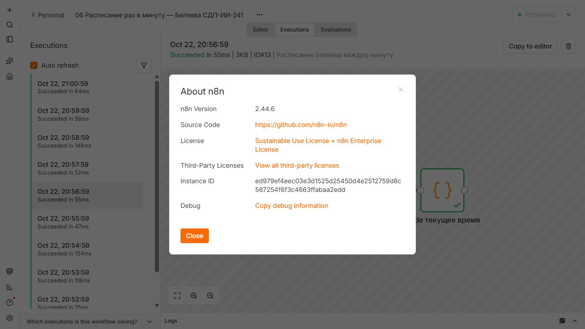

Команды запуска из Git Bash в папке `lab4`:

```bash
docker compose up -d
docker compose ps
```

Для PowerShell подготовлен `./start.ps1`, создающий локальные каталоги перед запуском. При первом старте n8n выполнил миграции своей SQLite-базы. Создан локальный владелец Екатерина Беляева с учебной почтой. Пароль хранится только локально в исключённом из Git runtime.

В n8n опубликован порт 5678, в Redis — 6379. Оба порта доступны через loopback компьютера. Для n8n заданы `TZ`, `GENERIC_TIMEZONE`, `N8N_HOST=localhost`, `N8N_PORT=5678`, `N8N_PROTOCOL=http`, `N8N_ENFORCE_SETTINGS_FILE_PERMISSIONS=true`. `N8N_SECURE_COOKIE=false` используется для локального HTTP. Диагностика и персонализация выключены. JavaScript выполняется встроенным task runner n8n; отдельные npm-пакеты для Code не требуются.

Обязательные два bind mount n8n: `runtime/n8n` → `/home/node/.n8n` для БД, аккаунта, workflow и credentials; `runtime/data` → `/data` для рабочих файлов. Redis сохраняет AOF в `runtime/redis` → `/data`. Все runtime-каталоги исключены из Git. Для установки использовалась [официальная документация n8n](https://docs.n8n.io/hosting/installation/docker/).

## Workflow

Созданы восемь отдельных workflow с фамилией и группой в названиях. Все сохранены в n8n, выполнены и экспортированы командой `n8n export:workflow --all --separate --pretty` в отдельные JSON в `lab4/flows`. Нумерация соответствует конкретным пунктам заданий: 01–06 и 09–10; заданий 07–08 в основной части методички нет.

### 1. Manual Trigger → Set → Code

В Set заданы `payload = "Беляева, СДП-ИИ-241"` и `topic = "lab4/belyeva/basic"`. Code выводит JSON в консоль и возвращает полученные данные. В n8n сообщение передаётся как item с полем `json`; просмотр результата выполняется через Output. Manual Trigger запускается кнопкой Execute и не требует постоянной публикации.

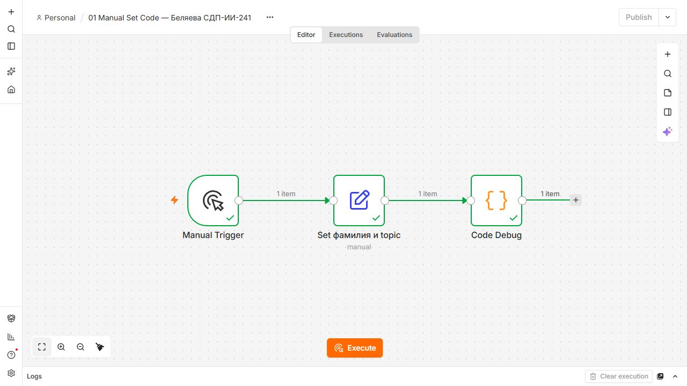

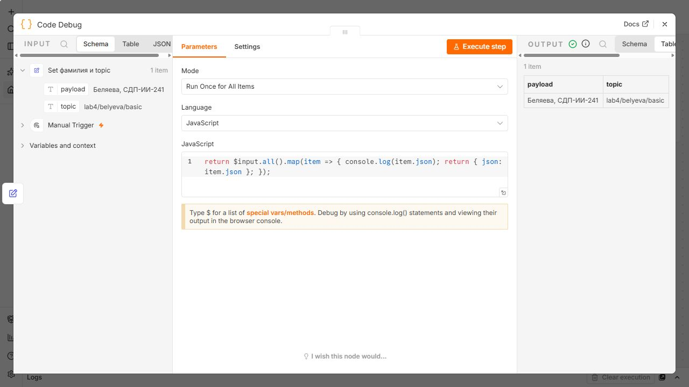

Экспорт: [flow-01-manual-set.json](../flows/flow-01-manual-set.json).

### 2. Code и NoOp

Цепочка Manual Trigger → Code → NoOp. В JavaScript используются `const`, `let`, объект student, массив `[20,5,10]`, цикл `for` и условие `if/else`. Сумма равна 35; при сумме не меньше 30 выбирается `high`, иначе `low`. Результат возвращается в объекте `payload`. NoOp передаёт данные без изменения.

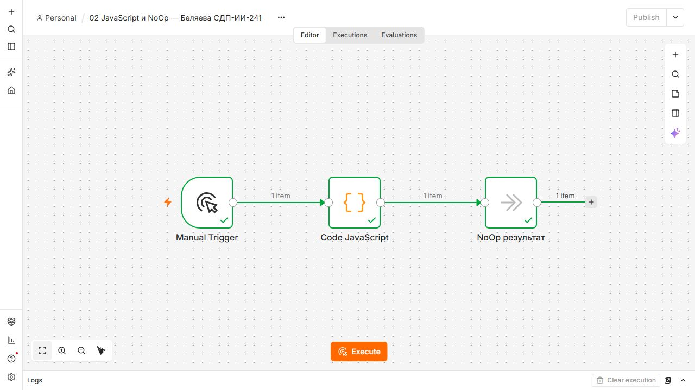

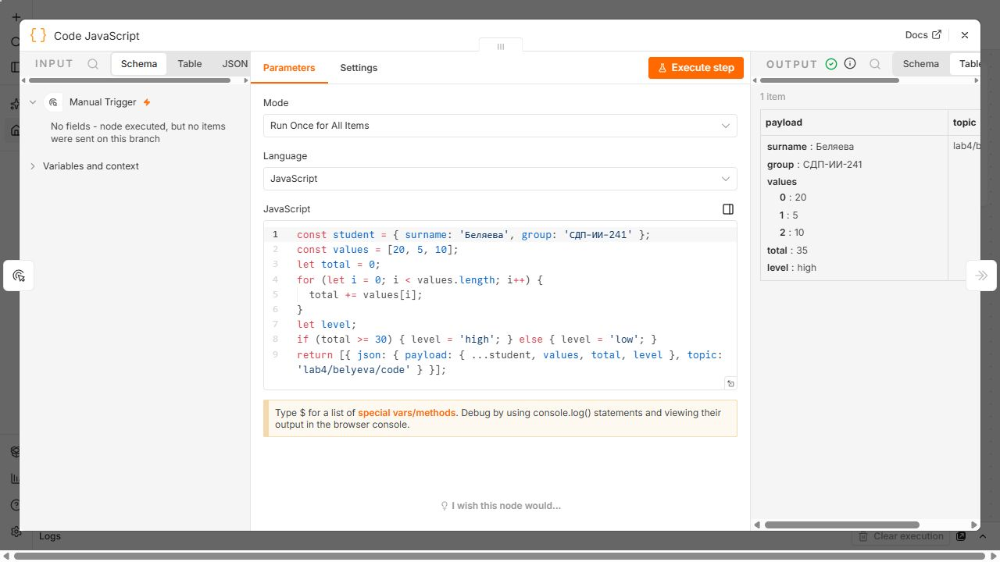

Экспорт: [flow-02-code.json](../flows/flow-02-code.json).

### 3. IF и две ветви

Code использует аналогичную логику и создаёт два item: `[20,5,10]` → 35, `[2,5,10]` → 17. IF проверяет числовое поле `payload.total >= 30`. В true попадает item с 35 и `high`, в false — с 17 и `low`. После каждого выхода стоит отдельная NoOp. Обе ветви проверены в одном выполнении.

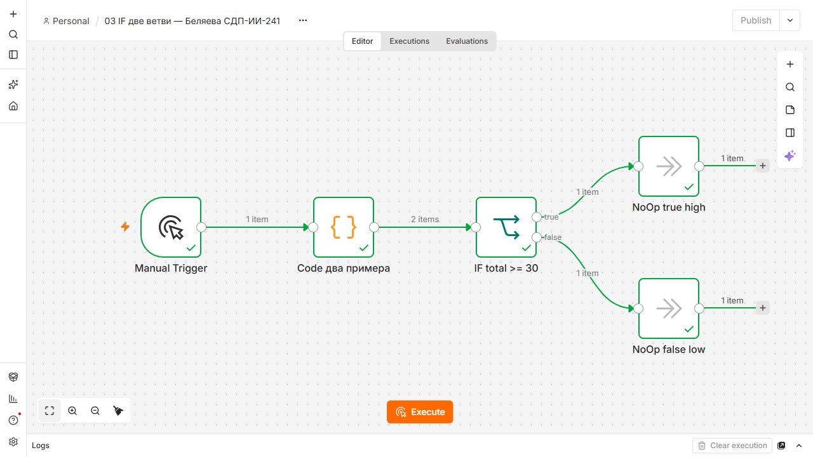

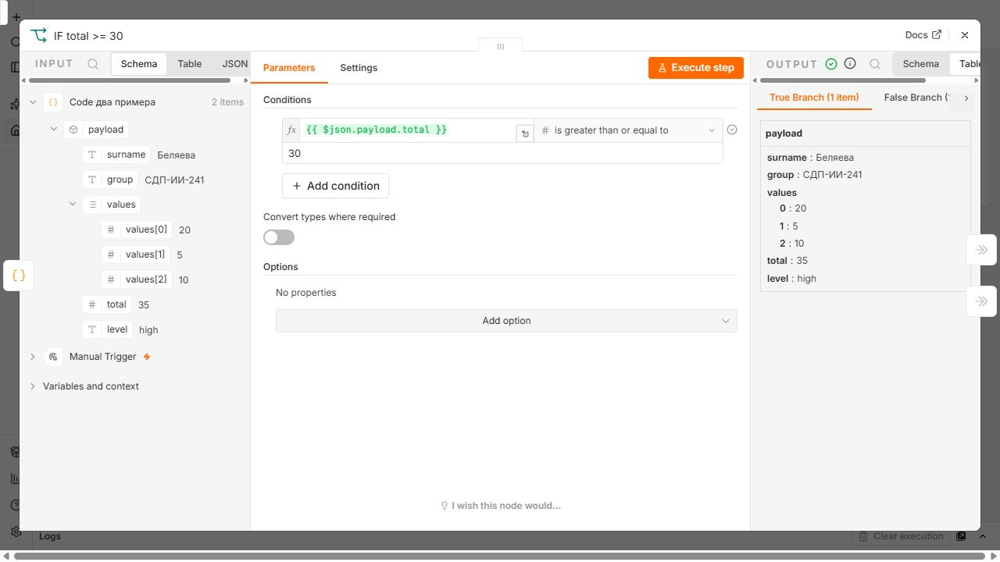

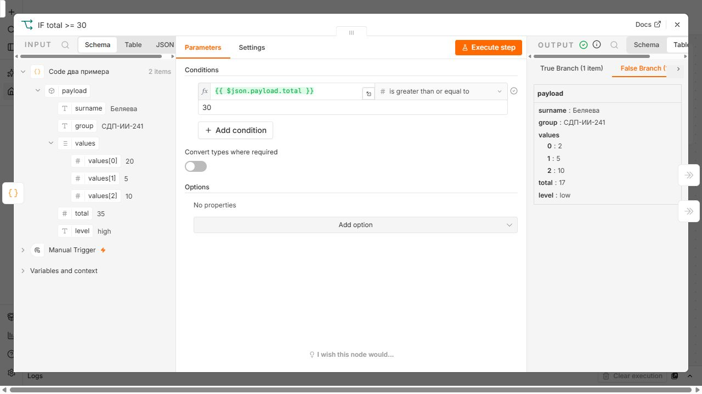

Экспорт: [flow-03-if.json](../flows/flow-03-if.json).

### 4. Set и полный объект

Set формирует `topic = lab4/belyeva/set`, `timestamp = {{ $now.toISO() }}` и payload с фамилией и группой. Timestamp вычисляется во время запуска и содержит смещение `+03:00`. Code возвращает полный объект `item.json`, включая все три поля.

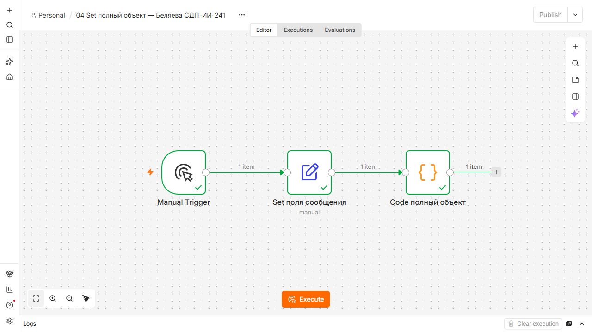

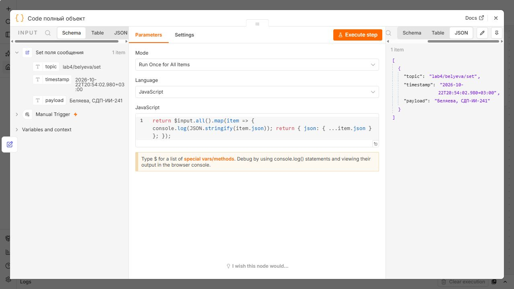

Экспорт: [flow-04-set.json](../flows/flow-04-set.json).

### 5. HTTP Request

Manual Trigger → HTTP Request → Code. Выполнен GET к `https://official-joke-api.appspot.com/random_joke`, авторизация None, Response Format JSON, timeout 30000 мс. API публичный и не требует регистрации или токенов. Code проверяет наличие строковых полей setup и punchline, затем возвращает ответ в payload вместе с фамилией, группой и topic. Запрос завершился успешно, проверка формата пройдена.

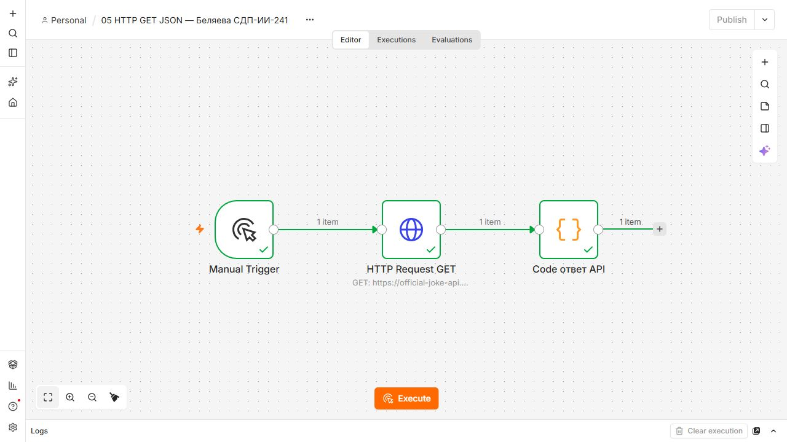

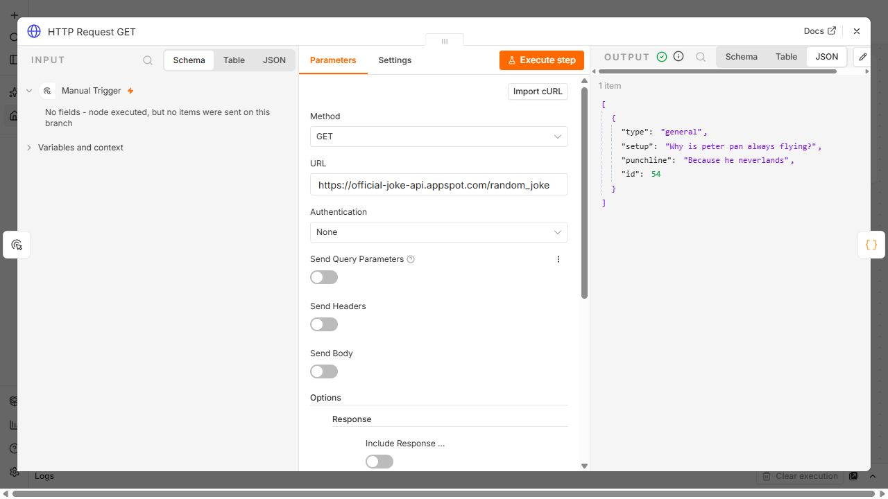

Экспорт: [flow-05-http.json](../flows/flow-05-http.json).

### 6. Schedule Trigger

Schedule Trigger настроен на запуск каждую минуту. Code возвращает текущее время, часовой пояс, фамилию, группу, topic и исходные данные триггера. Workflow опубликован: публикация включает расписание. Проверены настоящие автоматические выполнения с режимом `trigger`, а не только ручной тест. В истории виден минутный интервал между успешными запусками.

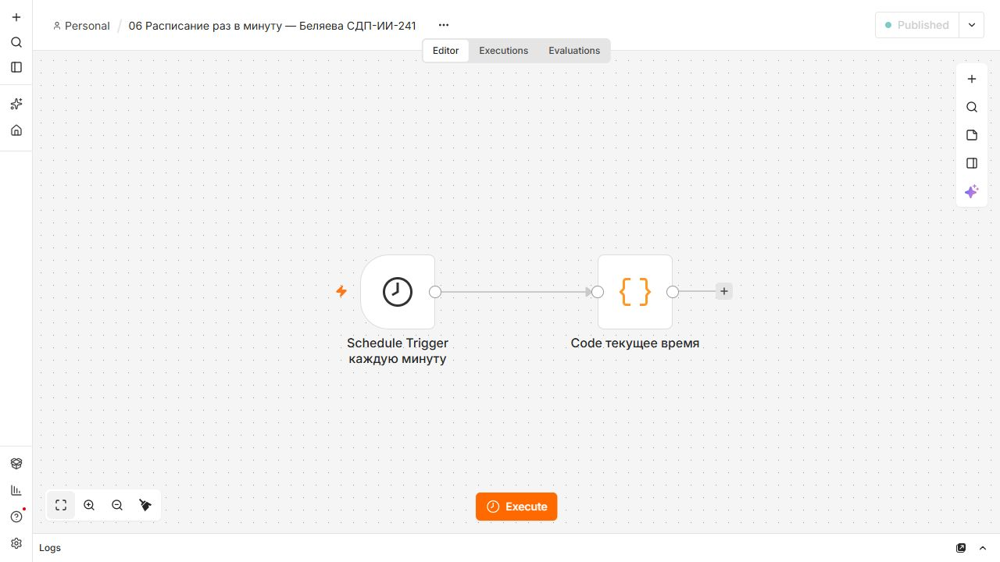

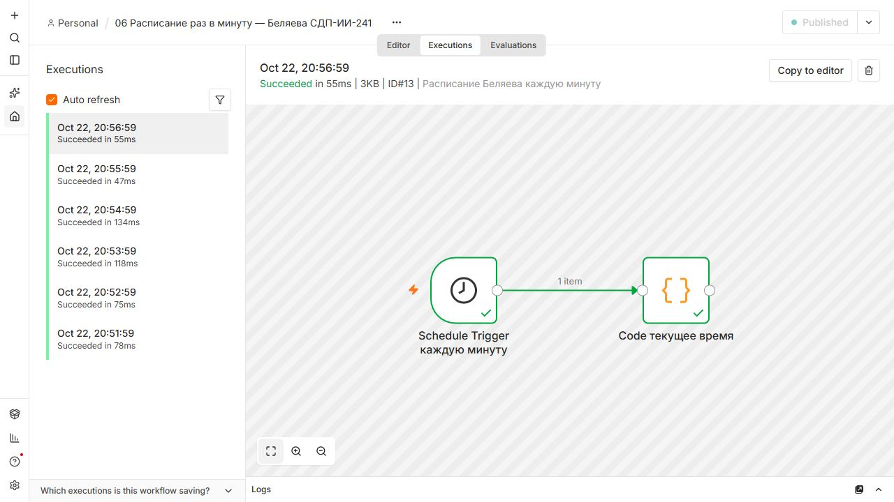

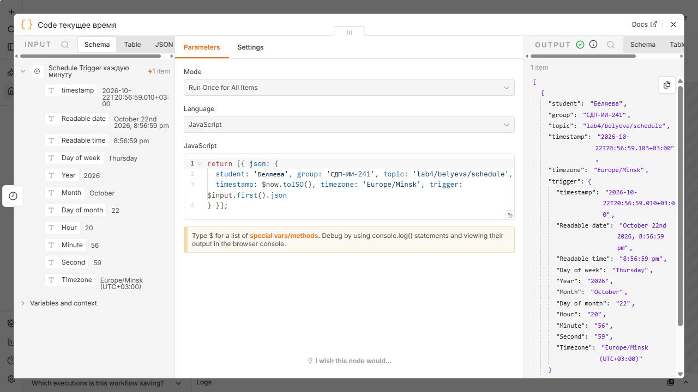

Экспорт: [flow-06-schedule.json](../flows/flow-06-schedule.json). Для демонстрации расписание оставлено опубликованным. На другой установке после импорта нужно отдельно включить Publish.

## Redis

Создан credential с Host `host.docker.internal`, Port `6379`, Database `0`. В workflow 09 нода Redis Set записывает строку `Беляева, СДП-ИИ-241 — лабораторная 4` по ключу `belyeva`, Redis Get читает её в поле value. Срок жизни ключа не задан.

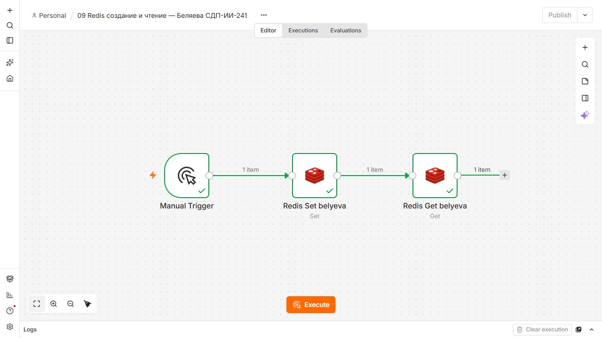

В workflow 10 Redis Delete удаляет ключ, Redis Get получает null, Code проверяет отсутствие и возвращает exists=false. В установленной встроенной Redis-ноде нет операции Exists, указанной в методичке; поэтому использованы Get + проверка null и независимая команда `redis-cli EXISTS belyeva`. До удаления команда вернула 1, после — 0.

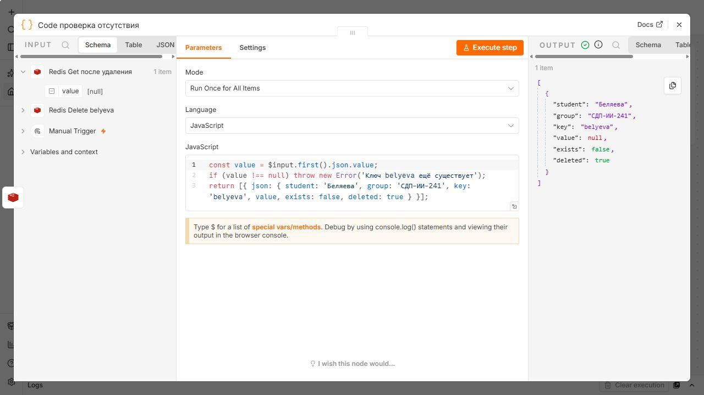

Подробные параметры, все четыре этапа и команды приведены в [redis.md](redis.md). Экспорты: [flow-09-redis.json](../flows/flow-09-redis.json), [flow-10-redis.json](../flows/flow-10-redis.json).

## Проверка результата

Проверка `verify.mjs` прочитала настоящую историю выполнений n8n и проверила выходы нод. Результат сохранён в [verification.json](verification.json): `allPassed: true`. Проверены все восемь workflow, обе ветви IF, структура ответа HTTP, автоматический режим Schedule, строка Redis и null после удаления. Контейнеры перезапущены; история выполнений сохранилась и повторная проверка прошла.

## Освоенные ноды

| Нода | Назначение в работе |
| --- | --- |
| Manual Trigger | Ручной запуск по кнопке |
| Set / Edit Fields | Создание и изменение полей JSON |
| Code | JavaScript, вычисления, диагностика и проверка результата |
| NoOp | Конечная нода без изменения данных |
| IF | Разделение items по числовому условию |
| HTTP Request | Получение JSON через публичный GET API |
| Schedule Trigger | Автоматический запуск каждую минуту |
| Redis | Set, Get, Delete и проверка отсутствия |

## Использование ИИ

Codex использовался для разбора методички, подготовки Docker и workflow, диагностики ошибок и проверки результата. Ключевые запросы: выполнить основную лабораторную по методичке, сделать скриншоты без курсора и объяснение для защиты; «Ачивку не делать»; «В оформлении отчётов опирайся на уже выполненные лабы». Запросы и задачи ИИ перечислены в [prompts.md](prompts.md).

## История коммитов

Этапы работы сохранялись с автором, настроенным в репозитории: Беляева Екатерина. Использованы осмысленные русские сообщения, как в предыдущих лабораторных. Историю можно показать командой `git log --oneline -- lab4`.

| Коммит | Дата | Изменения |
| --- | --- | --- |
| [19484d9](https://github.com/Katsia999/visual-programming-labs-Belyeva/commit/19484d9da7fe48009c3ff51365876da4e75e9696) | 2026-10-22 | Добавила структуру четвёртой лабораторной и запуск n8n с Redis |
| [615ddcd](https://github.com/Katsia999/visual-programming-labs-Belyeva/commit/615ddcd59ee32c685addf48e0ddb704cfc38fffd) | 2026-10-22 | Собрала первые потоки с Set и JavaScript |
| [a20adc1](https://github.com/Katsia999/visual-programming-labs-Belyeva/commit/a20adc1c51fdff5725c7a542b497044700d1d94f) | 2026-10-22 | Добавила ветвление IF и изменение полей сообщения |
| [a95b3ea](https://github.com/Katsia999/visual-programming-labs-Belyeva/commit/a95b3ead23b3849814423d8694cbbc0f88004713) | 2026-10-22 | Добавила HTTP-запрос и запуск по расписанию |
| [fc19da2](https://github.com/Katsia999/visual-programming-labs-Belyeva/commit/fc19da2f80ecc2da17d090af4b40beabc3d850b9) | 2026-10-22 | Собрала создание чтение и удаление ключа Redis |
| [33a327d](https://github.com/Katsia999/visual-programming-labs-Belyeva/commit/33a327daf99ffa3c83559ce01d2b29f504abd493) | 2026-10-22 | Проверила потоки в n8n и добавила экспорты со скриншотами |

Отчёт, описание Redis и инструкции запуска сохранены отдельным завершающим коммитом. Требование не менее шести коммитов выполнено.

## Вывод

Развёрнута локальная среда n8n и Redis, создано восемь работающих workflow. Я разобралась, как Set формирует поля, Code обрабатывает массив items, IF распределяет элементы между ветвями, HTTP Request получает JSON и Schedule Trigger запускает обработку по времени. На примере Redis проверены создание, чтение и удаление ключа. Данные среды сохраняются в локальных папках, а отдельные JSON позволяют перенести потоки. Для защиты важно различать ручной запуск и опубликованное расписание, а также адрес компьютера и localhost внутри контейнера.
