# Лабораторная работа №5. Чат-боты

**Студентка:** Беляева Екатерина. **Группа:** СДП-ИИ-241.

**Дата выполнения:** 22.10.2026. **Выбранный трек:** C — Typebot self-hosted.

## Цель работы

Освоить визуальную платформу для создания чат-ботов: адаптировать готовый шаблон, настроить переменные и условия, подключить внешний HTTP API, опубликовать сценарий и проверить результаты разговоров в админке.

## Среда и запуск

Typebot 3.19.1 развёрнут в Docker Desktop на Windows. Для работы используются отдельные контейнеры редактора Builder, опубликованного бота Viewer, PostgreSQL 16, Redis 7.4 и локальной почты Mailpit 1.27. Конфигурация находится в [docker-compose.yml](../docker-compose.yml).

| Адрес | Назначение |
| --- | --- |
| [Опубликованный бот](http://127.0.0.1:8081/lab5-belyeva-sdp-ii-241) | Веб-канал общения с ботом |
| [Редактор](http://localhost:8080/typebots/llfioldlul2uxwsjbpvh0pnb/edit) | Схема, переменные и настройки |
| [Результаты](http://localhost:8080/typebots/llfioldlul2uxwsjbpvh0pnb/results) | Сохранённые заявки и журналы |
| [Локальная почта](http://localhost:8025) | Письмо со ссылкой и кодом входа |

Ссылки работают на компьютере, где запущены контейнеры. Это опубликованная self-hosted версия; для просмотра преподавателем на другом компьютере потребуется развернуть установку или разместить её на сервере. Telegram для выбранного трека не подключался: методичка разрешает публикацию веб-ссылкой.

В PowerShell из папки `lab5` выполняется `./start.ps1`. Скрипт создаёт локальные каталоги и секреты при первом запуске, затем запускает контейнеры. Для повторного запуска из Git Bash используется:

```bash
docker compose up -d
docker compose ps
```

Остановка с сохранением данных: `docker compose stop`. Данные PostgreSQL и Redis находятся в `runtime`, секреты — в `.env`; эти файлы исключены из Git. Вход выполняется по учебной почте через письмо в локальном Mailpit: внешняя почтовая отправка не используется. Все опубликованные порты привязаны к loopback компьютера. При первом запуске исправлена проверка готовности PostgreSQL: она проверяет TCP, чтобы миграции Typebot запускались после полной инициализации базы.

Настройки основаны на [официальной инструкции Docker](https://docs.typebot.com/self-hosting/deploy/docker) и [справочнике конфигурации](https://docs.typebot.com/self-hosting/configuration). Для Preview редактор и viewer используют разные имена хоста — `localhost` и `127.0.0.1`.

## Workspace и исходный шаблон

Создано рабочее пространство **lab5-Беляева-СДП-ИИ-241**, указано имя Екатерина Беляева. В self-hosted установке учебная почта назначена администратором; интерфейс показывает план Unlimited. Это локальная конфигурация, платная подписка Typebot Cloud не приобреталась.

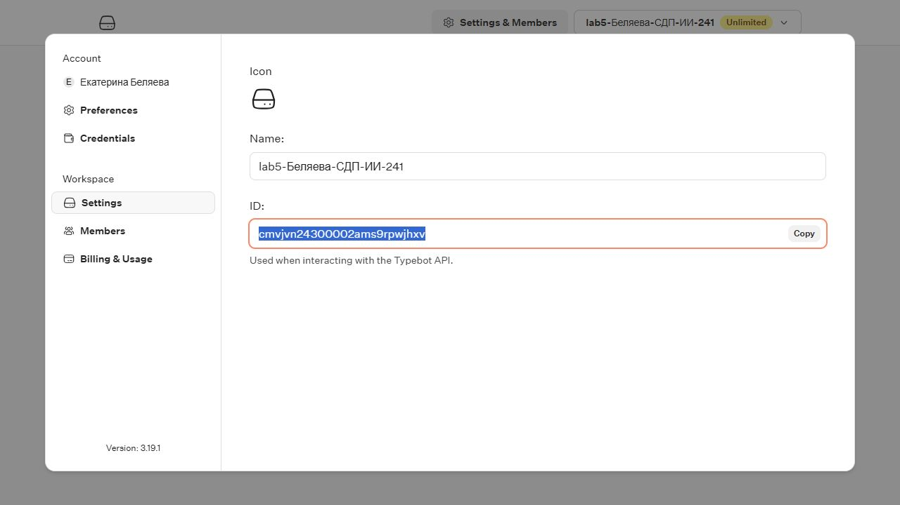

В `Create a typebot → Start from a template` выбран **Lead Generation**. Исходник собирает имя, почту, интересующую услугу и описание потребности. В workspace оставлена исходная версия `lab5-Беляева-СДП-ИИ-241-до-перевода`. [Оригинальный шаблон](https://github.com/baptisteArno/typebot.io/blob/v3.19.1/packages/templates/src/typebots/lead-gen.json) также сохранён в [JSON](../exports/template-lead-gen-original.json).

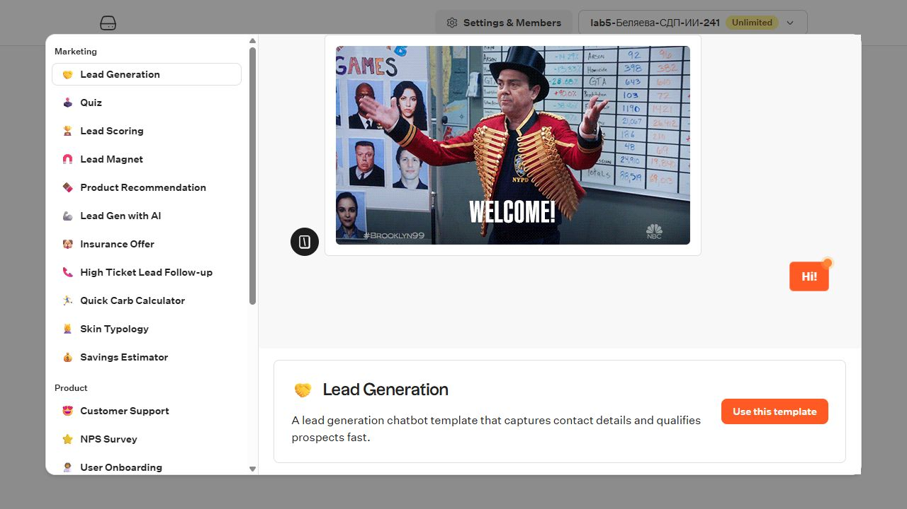

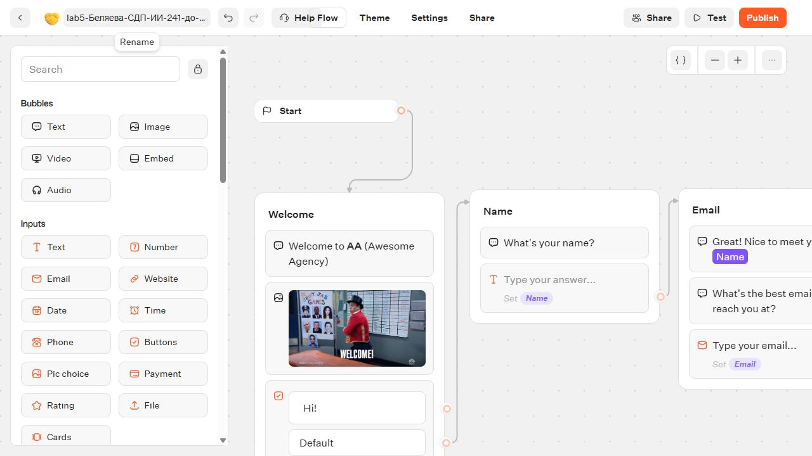

## Русификация и изменение назначения

Шаблон адаптирован под заявку на консультацию по лабораторным. Переведены приветствие, вопросы, варианты выбора, итог, плейсхолдеры, кнопки отправки, сообщение о неправильной почте, системные сообщения об ошибках и описание страницы. Переменные Name и Email переименованы в «Имя» и «Почта» с сохранением ID; текстовые подстановки заменены на `{{Имя}}` и `{{Почта}}`.

Вместо услуг агентства предлагаются темы «Node-RED и MQTT», «Bubble и CRUD», «n8n и Redis», «Typebot и чат-боты». Декоративная GIF удалена. Ответы сохраняются в Results; сценарий прямо сообщает, что это учебная демонстрация и настоящее письмо или уведомление преподавателю не отправляется.

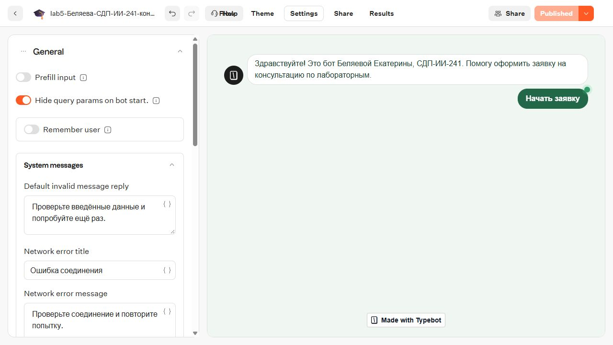

Итоговая тема использует светло-зелёный фон `#F0F6F2`, зелёные кнопки и ответы пользователя `#226747`, белые сообщения бота и тёмный текст. В финальной версии отключён англоязычный значок Made with Typebot, заголовок страницы и описание переведены. На ранних снимках проверки значок ещё виден; финальное приветствие и второй диалог сняты после его отключения. Названия инструментов самого редактора остаются на английском; перевод выполнен для интерфейса и сообщений созданного бота.

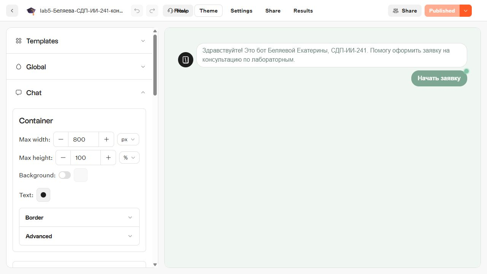

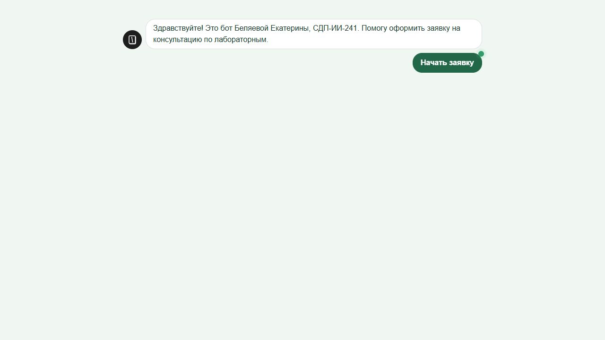

## Итоговый сценарий

Бот называется **lab5-Беляева-СДП-ИИ-241-консультация**. Он содержит 14 групп, 26 блоков, 7 переменных и 16 связей. Исходные вопросы шаблона сохранены и дополнены вводом группы, условием с двумя ветвями, записью маршрута, HTTP-запросом и обработкой его ошибки. Добавлено больше двух новых шагов.

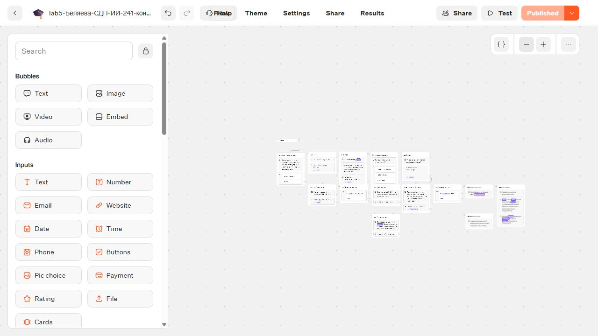

Для чтения блоков схема отдельно снята по частям:

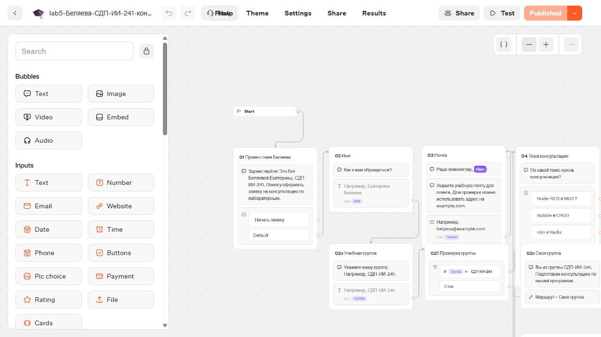

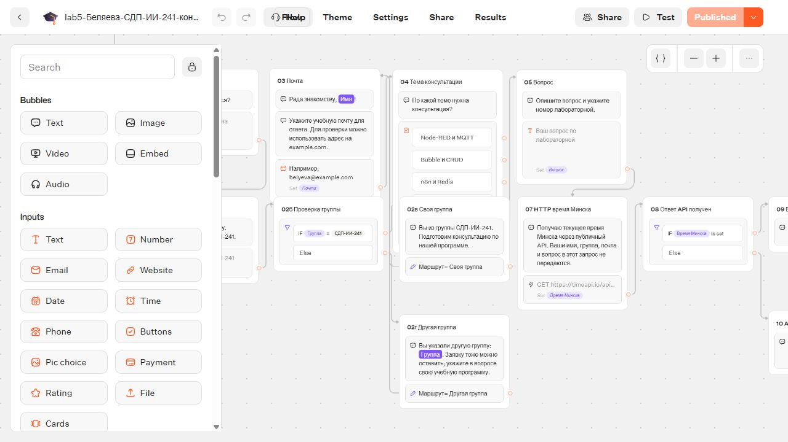

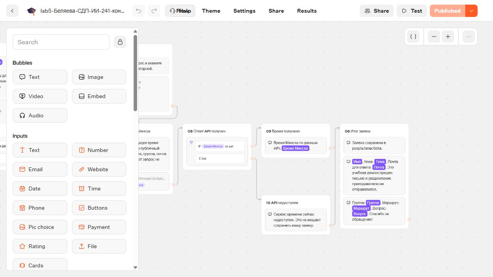

| Блок | Назначение |
| --- | --- |
| Start | Начинает разговор |
| Text | Показывает вопросы и сообщения с подстановками |
| Buttons | Начинает заявку и предлагает четыре темы |
| Text Input | Получает имя, группу и описание вопроса |
| Email Input | Проверяет формат почты и сохраняет адрес |
| Condition | Сравнивает группу; отдельно проверяет получение времени |
| Set Variable | Записывает выбранный маршрут |
| HTTP Request | Получает время Минска из публичного API |

### Переменные

| Переменная | Откуда берётся значение |
| --- | --- |
| Имя | Ответ на вопрос «Как к вам обращаться?» |
| Почта | Проверенный Email Input |
| Тема | Выбранная кнопка |
| Вопрос | Длинный Text Input |
| Группа | Новый Text Input |
| Маршрут | Set Variable после проверки группы |
| Время Минска | Поле `data.dateTime` ответа HTTP |

Поля ввода сохраняются в результатах. «Маршрут» и «Время Минска» настроены как session variables: используются в текущем разговоре, а выполнение Set Variable отражается в истории. Отображение значений проверено в итоговых сообщениях.

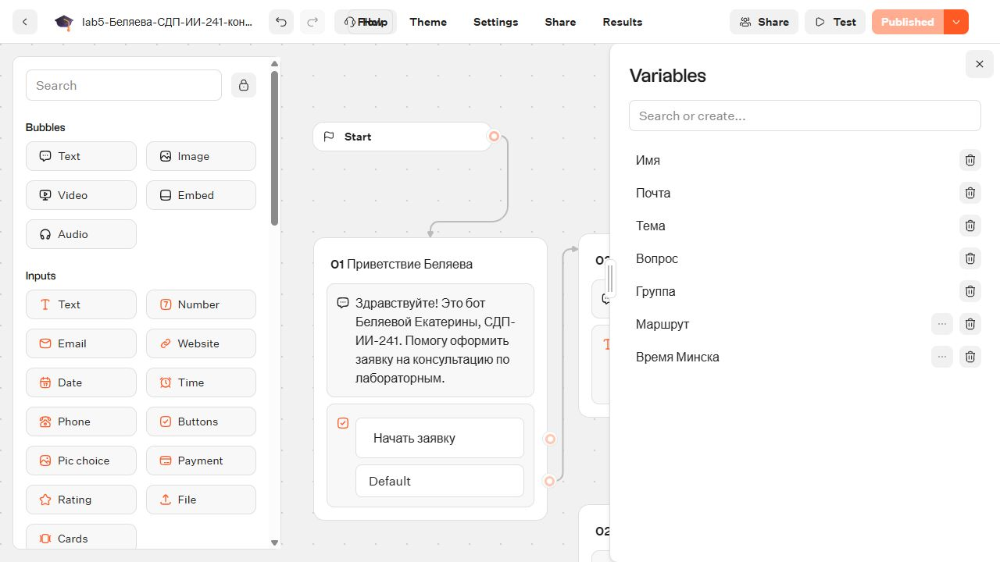

### Условие

Condition сравнивает «Группа» с `СДП-ИИ-241` оператором Equal to. При совпадении бот сообщает, что заявка относится к нашей программе, и записывает маршрут «Своя группа». В Else он показывает указанную другую группу и записывает «Другая группа». Обе ветви продолжаются вопросом о почте.

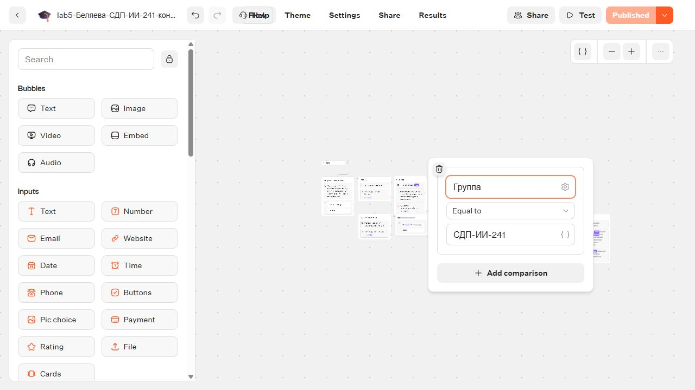

### HTTP Request

Использован публичный GET `https://timeapi.io/api/time/current/zone?timeZone=Europe/Minsk`. Авторизация не требуется. В запрос передаётся только часовой пояс; имя, группа, почта и описание вопроса в него не входят. Поле JSON `data.dateTime` сохраняется в переменную «Время Минска». В JSON Typebot этот блок имеет историческое имя типа `Webhook`, а в редакторе называется HTTP request.

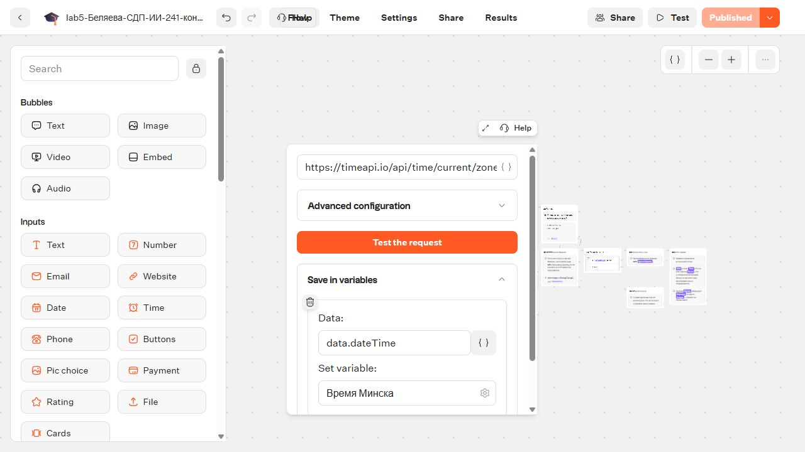

После запроса второй Condition проверяет Is set. При наличии времени оно выводится пользователю. При отсутствии бот сообщает о недоступности сервиса и переходит к итогу; заявка не теряется.

## Публикация и экспорт

Нажата Publish, выбран адрес `lab5-belyeva-sdp-ii-241`. Проверка выполнялась по опубликованной веб-ссылке в отдельных диалогах. После изменения настроек версия публиковалась повторно.

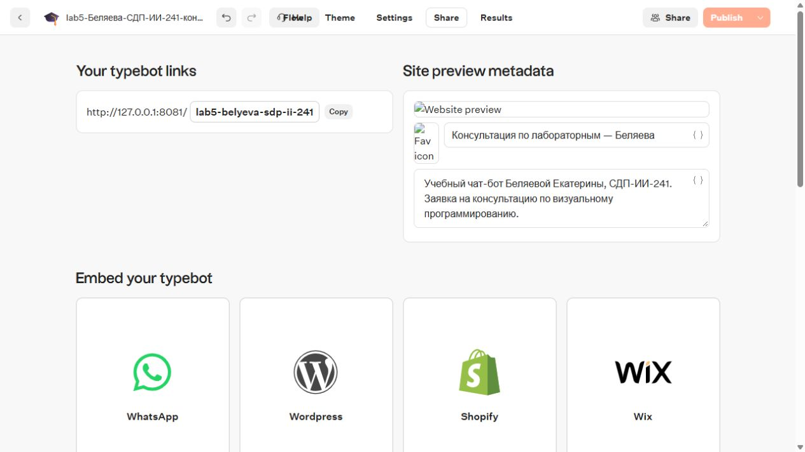

Подготовленные JSON были импортированы штатным RPC-методом Typebot: файловый диалог встроенного браузера не открыл импорт. Итоговый flow получен штатным методом чтения сценария из работающей платформы, без правки базы. Сохранены следующие варианты:

- [flow-01-belyeva-ru.json](../exports/flow-01-belyeva-ru.json) — перевод шаблона.
- [flow-02-belyeva-condition.json](../exports/flow-02-belyeva-condition.json) — ввод группы, переменные и ветвление.
- [flow-03-belyeva-final.json](../exports/flow-03-belyeva-final.json) — подготовленная итоговая схема.
- [flow-04-belyeva-export.json](../exports/flow-04-belyeva-export.json) — **итоговый экспорт из запущенного Typebot**; его следует импортировать на другой установке.

Экспорт переносит сценарий, тему и настройки. Пользовательские ответы остаются в PostgreSQL текущей установки. После импорта на другом компьютере нужно нажать Publish и использовать ссылку нового viewer.

## Проверка результата

Все диалоги выполнены в браузере, скриншоты получены браузерным захватом без указателя мыши и без дорисовки содержимого.

| Проверка | Фактический результат |
| --- | --- |
| Имя Екатерина Беляева, группа СДП-ИИ-241 | Ветка «Своя группа», имя подставлено в приветствие и итог |
| Группа СДП-ИИ-242 | Ветка «Другая группа», показано введённое значение |
| Почта `непочта` | Браузер отклонил адрес без символа @ |
| Почта `belyeva@localhost` | Typebot показал настроенное русское сообщение и предложил повторить ввод |
| Исправление на `belyeva@example.com` | Диалог продолжился, правильная почта сохранена |
| HTTP-запрос | Получено и показано время Минска |
| Искусственный HTTP 404 | Показана ветка недоступности сервиса, заявка завершена |
| Results | Видны три завершённые заявки |
| Перезапуск PostgreSQL, Redis, Builder и Viewer | Сохранены те же ID заявок, ответы и сценарий |

Для проверки HTTP 404 временно использован несуществующий путь на том же сервисе времени. После теста рабочий URL восстановлен и сценарий опубликован заново. В финальном экспорте сохранён рабочий адрес.

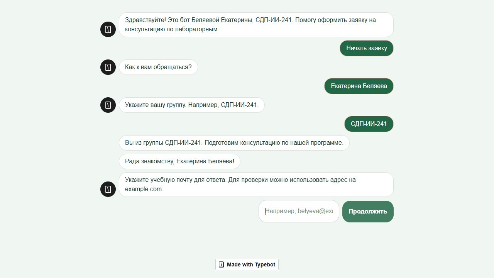

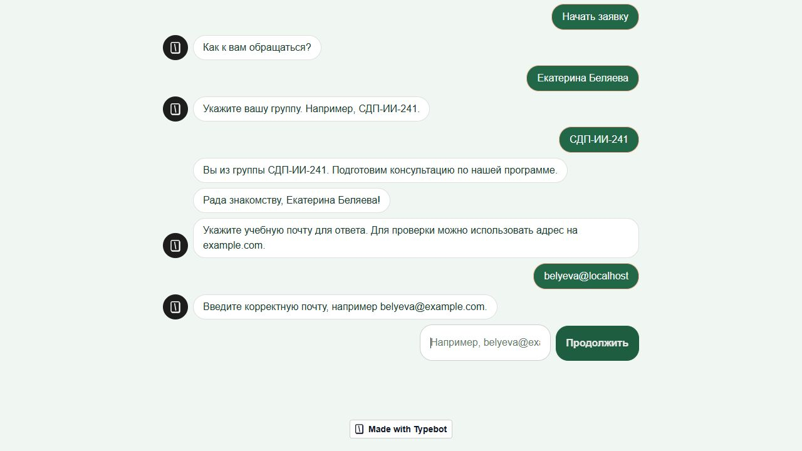

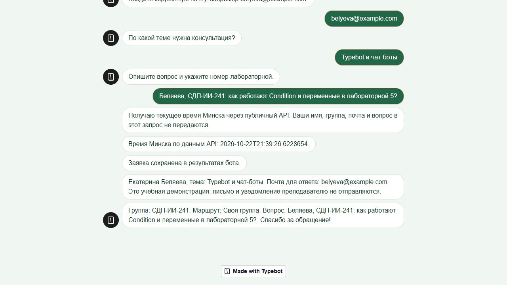

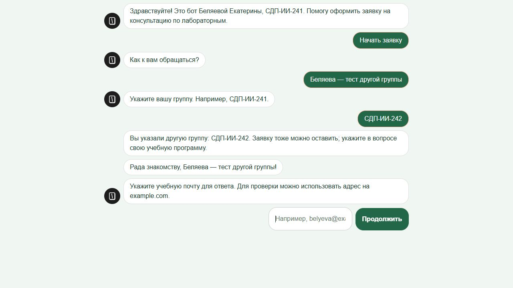

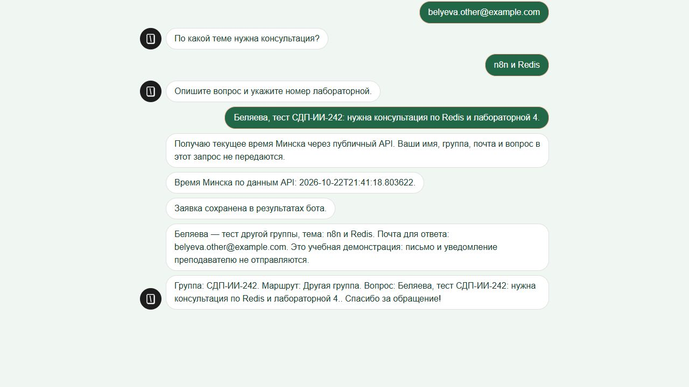

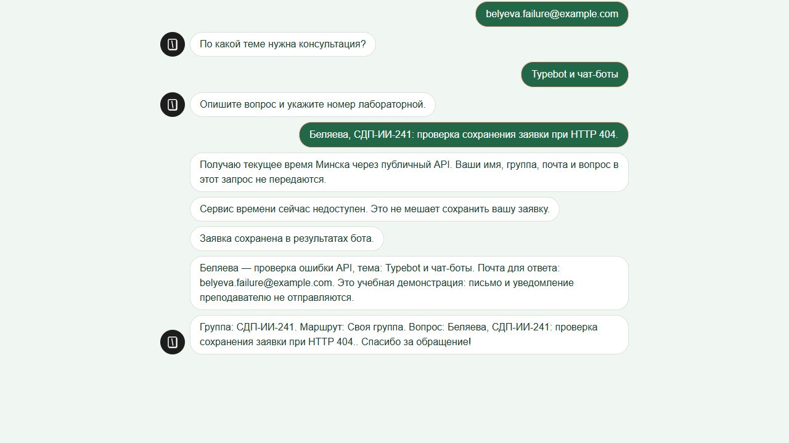

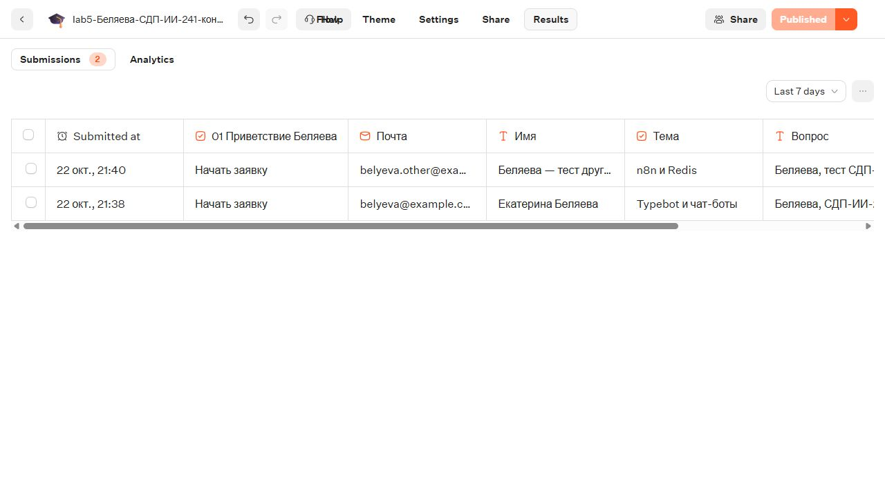

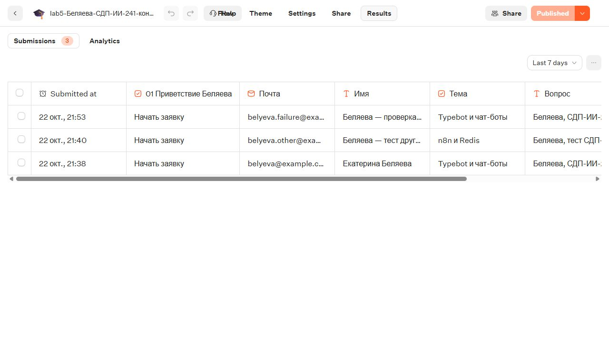

Проверка [verify-exports.mjs](../verify-exports.mjs) подтвердила существование ссылок, переменных и достижимость всех 14 групп итогового экспорта. [verify-runtime.ps1](../verify-runtime.ps1) прочитала реальные результаты, историю Set Variable, посещённые условные переходы и журналы HTTP. В Typebot Else не записывается в VisitedEdge, поэтому другая группа проверяется по записи «Другая группа» в истории Set Variable, а ошибка API — по журналу ошибки, отсутствию успешной ветви и завершению заявки; экран ветви сохранён отдельно. Результаты: [verification.json](verification.json) и [persistence-check.json](persistence-check.json), в обоих `allPassed: true`.

## История коммитов

Этапы сохранены через Git Bash с именем и почтой, настроенными в репозитории. Команда для показа истории: `git log --oneline -- lab5`.

| Коммит | Дата | Изменения |
| --- | --- | --- |
| [422d94c](https://github.com/Katsia999/visual-programming-labs-Belyeva/commit/422d94cb4503a6ce01abf5f3f0513b65cba66ce7) | 22.10.2026 | Добавила структуру пятой лабораторной и запуск Typebot |
| [ba44e03](https://github.com/Katsia999/visual-programming-labs-Belyeva/commit/ba44e03ae9e10b70473d6f91049fdfd8a02821d1) | 22.10.2026 | Перевела шаблон заявки на консультацию на русский язык |
| [84e7519](https://github.com/Katsia999/visual-programming-labs-Belyeva/commit/84e7519ef006be13d7d836fcdc6542df542ac3fe) | 22.10.2026 | Добавила переменные и проверку учебной группы |
| [6d37cf6](https://github.com/Katsia999/visual-programming-labs-Belyeva/commit/6d37cf6c69a777f0295e9b3a6590640f9485b26b) | 22.10.2026 | Подключила API времени и настроила оформление бота |
| [ecacb4f](https://github.com/Katsia999/visual-programming-labs-Belyeva/commit/ecacb4f4e9842eed9187ff54c996ff6e3c4164a2) | 22.10.2026 | Проверила импорт и публикацию бота в Typebot |
| [f6deb6a](https://github.com/Katsia999/visual-programming-labs-Belyeva/commit/f6deb6a0203731395896c2bfa78f1a6983a49251) | 22.10.2026 | Добавила скриншоты диалогов и проверку сохранения заявок |
| [f6792a0](https://github.com/Katsia999/visual-programming-labs-Belyeva/commit/f6792a077646a79d6ef962e526e2a87d94af006b) | 22.10.2026 | Оформила отчёт и инструкции к пятой лабораторной |

Отчёт и итоговая проверка требований сохранены отдельным завершающим коммитом. Требование не менее шести осмысленных коммитов выполнено.

## Вывод

Я разобралась, как из готового шаблона создать собственный сценарий чат-бота. Перевод затрагивает не только вопросы, но и кнопки, плейсхолдеры, ошибки и подстановки переменных. На примере учебной группы проверила разные переходы Condition, а через HTTP Request получила внешние данные и предусмотрела продолжение работы при ошибке. Бот опубликован по локальной веб-ссылке, результаты разговоров сохраняются после перезапуска, а JSON позволяет перенести сценарий в другую установку Typebot.

## Использование ИИ

При выполнении лабораторной я использовала помощь ИИ на отдельных этапах: при разборе требований, подготовке конфигурации Docker, переводе и доработке JSON шаблона, проверке сценария и формулировке пояснений к работе. Основой бота стал готовый шаблон Lead Generation. Полученные настройки и рекомендации проверялись в работающем Typebot. Сам бот следует заданному сценарию и не использует языковую модель во время разговора.

Примеры задач, для которых использовалась помощь ИИ, в сокращённой форме:

1. Разобрать требования методички и подобрать вариант локального запуска Typebot.
2. Подготовить конфигурацию Docker и разобраться с ошибкой первого запуска базы данных.
3. Перевести шаблон Lead Generation, сохранив связи блоков и ссылки на переменные.
4. Настроить проверку группы через Condition и получение времени через HTTP Request.
5. Проверить логику диалогов и подготовить понятные пояснения о переменных, условиях и интеграции.

Подробнее: [prompts.md](prompts.md). Объяснение для защиты сохранено отдельно локально и исключено из Git.
